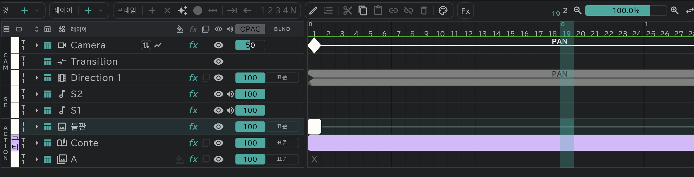

# 카메라·디렉션·트랜지션

타임라인 맨 위 **CAM** 구역에서 카메라워크와 화면 전환을 다룹니다. 위에서부터 카메라·트랜지션·디렉션 순서입니다.

## 카메라

- 키로 카메라의 **위치**·**비율**(확대)·**회전** 을 정합니다. 행을 펼치면 셋이 따로 레인이 되어 레인마다 키를 둡니다. 캔버스·재생·출력이 그대로 움직입니다.
- 키는 그 컷의 프레임 안에만 놓입니다. 컷 길이를 바꾸면 끝 키가 끝을 따라갑니다.
- 키를 고르고 [편집 버튼](/ko/timeline?id=편집-버튼)을 누르면 키 이름과 함께 **도착**·**출발** 의 속도(**리니어**·**천천히**·**급하게**·**부드럽게**·**홀드**)와 **세기** 를 정합니다. 키 마크가 그 모양으로 바뀝니다.
- 위치 키는 **경로** 를 **직선**·**곡선** 으로 고릅니다. 곡선이면 캔버스에서 핸들로 휩니다. **로빙** 을 켜면 그 키의 시간이 풀려, 앞뒤 키 사이를 고른 속도로 지나갑니다(처음·끝 키는 시간이 고정입니다).
- 카메라 행의 **그래프** 버튼으로 **값**·**속도** 그래프를 봅니다.
- 이름 칸 끝의 **카메라 경로** 버튼으로 카메라가 지나는 길을 캔버스에 그립니다.
- 카메라 행의 눈은 카메라 뷰를 켜고 끄고, 옆의 막대는 프레임 바깥을 어둡게 하는 정도입니다.
- 확대하면 **T.U**, 축소하면 **T.B**, 그 밖에 움직이면 **PAN** 이 카메라 행에 저절로 적히고 타임시트에도 찍힙니다.

## 트랜지션

- FI·FO·WI·WO·O.L 같은 화면 전환을 넣습니다. 종류는 [편집 버튼](/ko/timeline?id=편집-버튼)으로, 길이는 블록 끝을 끌어서 바꿉니다. 캔버스·재생·출력에 그대로 보입니다.
- O.L 은 두 컷에 걸치므로 [콘티](/ko/storyboard) 패널에서 편집합니다.

## 디렉션

- PAN·T.U·T.B 같은 지시를 블록으로 적습니다. 시트에 적는 표기라 화면을 움직이지는 않습니다.
- 디렉션 행에는 그림도 그릴 수 있습니다.

셋 다 [타임시트](/ko/sheets)의 CAM 칸에 바로 찍힙니다.
