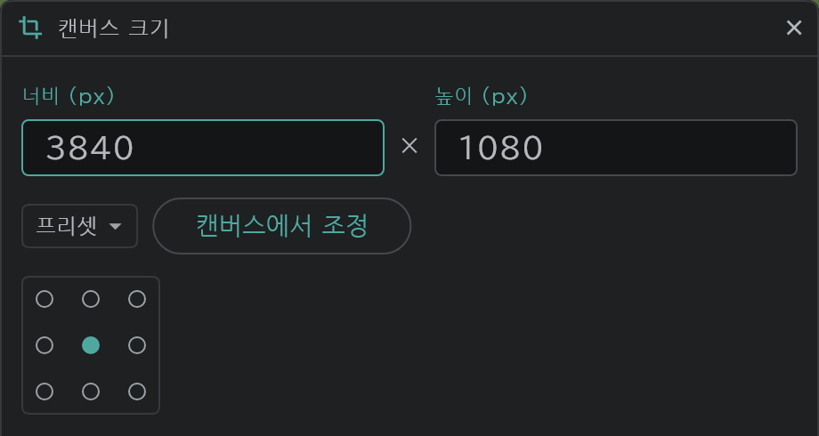

# 컷별 캔버스 크기

컷마다 캔버스 크기를 따로 정할 수 있습니다. 긴 PAN 배경이 필요한 컷만 넓게 만드는 식입니다.

- 타임라인 위쪽 **컷** 을 누르고 → **캔버스 크기…** 를 엽니다. 지금 컷에 적용되고, [겸용컷](/ko/linked-cuts)이면 이어진 컷도 함께 바뀝니다.
- **프리셋**(A4 150·200·300dpi, HD·FHD·2K·4K)에서 고르거나 너비와 높이를 적고, 3×3 칸에서 기존 그림이 고정될 위치를 고릅니다.
- **캔버스에서 조정** 을 누르면 창이 닫히고 캔버스의 가장자리를 끌어 크기를 바꿉니다. 끄는 반대편 가장자리가 고정되고, 체크나 Enter 로 확정합니다.
- 카메라는 그림과 함께 옮겨져, 크기를 바꿔도 화면에 잡히는 그림이 그대로입니다.
