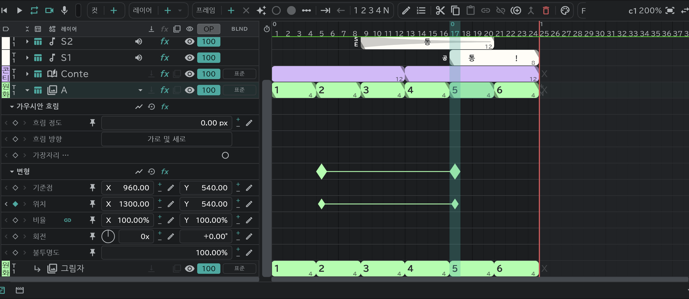
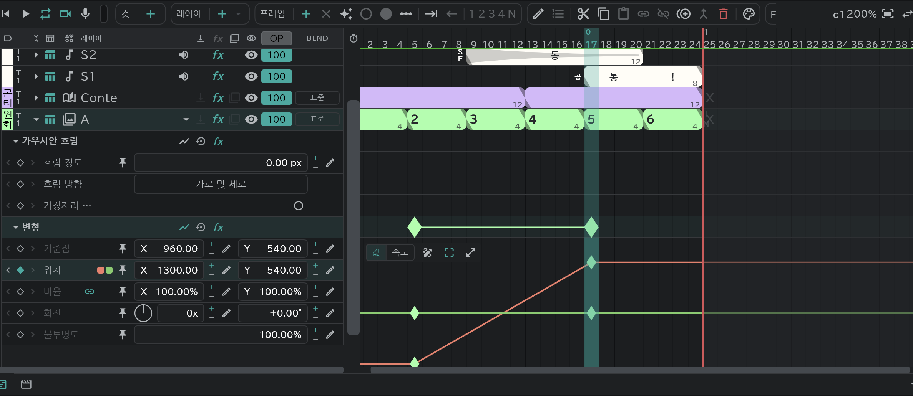

# 이펙트와 변형

레이어 줄의 **▸** 를 누르면 그 레이어의 **레인** 이 펼쳐집니다. 레인 하나가 값 하나이고, 레인에 **키**(◆)를 두면 그 값이 시간에 따라 바뀝니다.

## 변형

애니메이션 · 콘티 · 이미지 · 폴더 · SE 레이어에 있습니다.

- **회전** 은 바퀴 수와 각도 두 칸(450° = **1x** · **+90.00°**). 앞의 다이얼을 원을 그리듯 끌어도 돌아갑니다.
- 머리 줄 오른쪽: **그래프** · **리셋**(값을 처음으로, 키는 남음) · **fx**(우회 / 적용).
- 변형 도구로 그 레이어를 잡으면 캔버스에서 손으로 위치 · 크기 · 회전을 바꿉니다.

## 이펙트

레이어를 고르고 타임라인의 **Fx** 버튼에서 추가합니다. [콘티 패널](/ko/storyboard)의 콘티 행(과 그 어태치 행)에서도 같은 버튼으로 추가합니다 — 콘티 행에 넣으면 그 트랙의 콘티가 있는 모든 컷에 생깁니다.

| 이펙트 | 값 |
|---|---|
| **명도 및 대비** | 명도 · 대비(−100~100) |
| **색조/채도** | 마스터 색조(−180~180°) · 마스터 채도 · 마스터 밝기 |
| **가우시안 흐림** | 흐림 정도 · 흐림 방향(가로 및 세로 / 가로 / 세로) · **가장자리 픽셀 반복**(켜면 캔버스 가장자리가 비치지 않고 꽉 찬 채로) |
| **방사형 흐림** | 적용량 · 유형(**회전** / **확대/축소**) · 중심(캔버스의 십자를 끌기) · 안티앨리어스(최고 / 드래프트) |
| **방향 흐림** | 방향(각도) · 흐림 길이 |
| **카메라 렌즈 흐림** | 흐림 반경(0~500) · 모양(삼각형 ~ 십각형, 처음은 사각형) · 원형률 · 종횡비 · 회전 · 에돌이 줄무늬(가장자리만 밝은 고리) · 가장자리 픽셀 반복 |
| **색상 키** | 키 작업(**키 색상**: 고른 색을 지움 / **색상 유지**: 바로 앞의 키가 지운 것 중 고른 색을 되돌림) · 키 색 · 허용차 · 적용량 |
| **셀 번호** | 그림에 셀 번호(A1 …)를 찍음 · 위치 · 비율 · 잉크(애니메이션 · 콘티 · 이미지만) |

- 위에서부터 차례로 걸립니다. 순서는 자유롭게 바꿀 수 있습니다.
- 레이어 줄의 **fx** 칸은 그 레이어의 이펙트 전체를 한꺼번에 우회 / 적용합니다.
- 지우려면 그 이펙트의 머리 줄을 고르고 **삭제**.
- 아래 레이어 전체에 걸려면 [조정 레이어](/ko/adjustment-layers).
- 카메라 · 트랜지션 행에는 없습니다. [어태치 레이어](/ko/attach-layers)는 본 레이어의 변형 · 이펙트를 따릅니다(콘티 레이어에 붙은 어태치는 자기 것).
- [출력](/ko/export)의 **레이어 FX**: 켬 / 기본만 켬 / 끔.

## 키 만들기

- 플레이헤드를 둔 프레임에서 레인의 **◆** 를 누르면 그 자리의 값으로 키가 생깁니다(다시 누르면 지워짐).
- 키가 있는 레인에서는 값을 끌거나, 연필 버튼으로 숫자를 넣거나, 캔버스에서 손잡이를 끌어도 그 프레임에 키가 생깁니다.
- 레인 칸을 고르고 **프레임 ＋** 로도 만듭니다.
- 키를 끌면 시간이 옮겨집니다. 복사 · 붙여넣기 · 삭제는 그림 블록과 같습니다.

## 키 편집 창

키를 고르고 **편집** 또는 키를 더블클릭합니다.

| 항목 | |
|---|---|
| 이름 | 겸용컷끼리 같이 씀 |
| 도착 · 출발 | 앞 키에서 들어오는 · 다음 키로 나가는 빠르기. **홀드** 는 다음 키까지 값을 그대로 |
| 세기 | 그 빠르기 변화가 구간의 얼마만큼에 걸치는지 |
| 경로 · 로빙 (위치 키) | 키 사이를 지나는 길 · 키의 시간을 풀어 고른 빠르기로(처음 · 마지막 키 제외) |

키 마크의 모양이 고른 빠르기를 따라 바뀝니다.

## 그래프

머리 줄이나 레인의 **그래프** 버튼으로 레인 아래에 펼칩니다.

- **값 / 속도**: 값 곡선과 빠르기 곡선을 바꿔 봅니다.
- 키를 끌어 값 · 시간을 옮기고, 손잡이로 감속을 조절합니다.
- **펜**(켜면 곡선을 눌러 키를 더함 — 꺼져 있어도 <kbd class="k-pc">Ctrl</kbd><kbd class="k-mac">⌘</kbd>+클릭) · **변형 상자**(고른 키들을 상자로 옮기고 늘이기) · **크게 보기**.
- 빈 곳을 끌면 상자 안의 키가 골라집니다.
- **모든 그래프에 고정**: 다른 그래프를 볼 때도 그 레인을 계속 겹쳐 둡니다.
