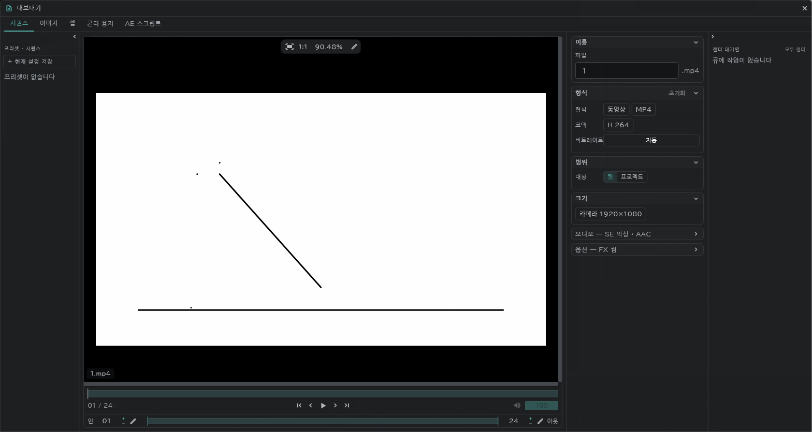
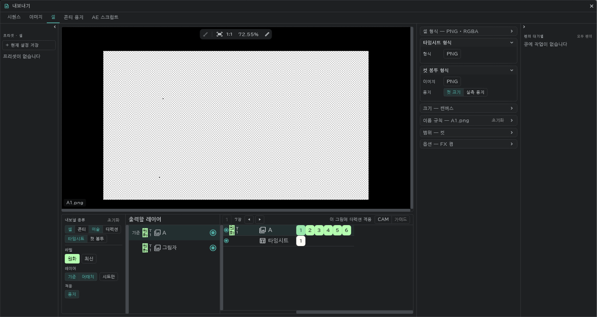

# 출력

왼쪽 위 **프로젝트**(폴더 아이콘) → **내보내기** 에서 한 창으로 출력합니다.

## 탭

| 탭 | 내는 것 |
|---|---|
| **시퀀스** | 동영상(MP4 · MOV) 또는 연번 그림 |
| **이미지** | 지금 프레임 한 장(PNG · JPG · PSD · BMP · TGA · TIFF · WEBP) |
| **셀** | 그림 한 장 = 파일 한 장, 그리고 타임시트 · 컷 봉투 |
| **콘티 용지** | 콘티 용지를 PDF(벡터) 또는 PNG · JPG 로 |

## 시퀀스(동영상)

| 항목 | 내용 |
|---|---|
| 이름 | 파일 이름(연번 그림은 이름 규칙) |
| 형식 | 연번 그림 · **MP4**(H.264 · H.265) · **MOV**(H.264 · ProRes Proxy · LT · 422 · HQ · 4444) |
| 코덱 설정 | 비트레이트 · 품질 · 채널 · 배경(흰색 / 검정 등) |
| 범위 | **컷**(지금 컷) / **프로젝트**(모든 컷) |
| 크기 | **카메라**(카메라 틀) / **캔버스** / **캔버스(컷마다)** |
| 오디오 | **SE 믹스를 영상에 먹싱** — SE 줄의 소리를 함께 넣기(음소거한 줄은 빠짐) |
| 옵션 · 레이어 FX | FX 켬 / 기본만 켬 / FX 끔 |
| IN / OUT | 미리보기에서 낼 구간 |

- 이 기기에서 못 쓰는 코덱은 꺼진 채 보입니다. 이 컴퓨터의 PATH 에 **FFmpeg** 가 있으면 그것으로 낼 수 있습니다.
- 출력하는 동안에는 창의 설정이 잠기고 **취소** 만 누를 수 있습니다. 취소해도 그때까지의 영상은 남깁니다.

## 셀

그림 한 장을 파일 한 장으로 냅니다. 타임시트와 컷 봉투도 여기서 냅니다.

| 항목 | 내용 |
|---|---|
| 셀 형식 | PNG · JPG … |
| 타임시트 형식 | PNG · JPG · XDTS |
| 컷 봉투 형식 · 크기 | 컷 크기 / 실측 용지 |
| 내보낼 종류 | 셀 · 콘티 · 미술 · 디렉션 · 타임시트 · 컷 봉투 |
| 라벨 | [색 라벨](/ko/layer-labels)과 테이크(최신 / 테이크 n)로 고르기 — 예: 원화의 최신 테이크만 |
| 레이어 | **기준**(본 레이어) · **어태치** · **시트만**(타임시트에 올린 줄) · 커스텀 |
| 이름 규칙 | 폴더 생성(프로젝트 / 컷 / 레이어) · 접두사 · 자릿수 · 접미사 |
| 범위 | 컷을 골라서(컷 격자에서 켜고 끄기) |

- 미리보기 아래 목록에서 줄마다, 그림마다 끄고 켭니다.
- 목록 위 띠에서 그림에 디렉션 · 카메라 경로 · 가이드를 겹쳐 냅니다.
- 파일 이름은 레이어 이름과 그림 번호입니다(예: `A1.png`).
- [어태치 레이어](/ko/attach-layers)는 본 레이어와 합쳐진 한 장으로 나옵니다.
- [겸용컷](/ko/linked-cuts)은 한 컷으로 다룹니다. 타임시트는 이어진 컷마다 나옵니다.

## 콘티 용지

- **벡터 PDF**: 글자 · 선이 확대해도 깨지지 않는 PDF. 인쇄 · 배포용.
- **페이지 이미지**: 페이지마다 PNG · JPG.

## 프리셋과 대기열

- **프리셋**: 창 옆의 프리셋 서랍에서 **+ 현재 설정 저장** 으로 지금 설정을 이름 붙여 두고, 다음에 눌러 불러옵니다.
- **대기열**: **큐에 추가** 로 설정을 여러 개 쌓아 두고, **렌더 대기열** 서랍에서 **모두 렌더** 로 한 번에 냅니다(예: 컷 영상 + 셀 + 타임시트).

## 저장 위치

저장할 곳은 **[내보내기]** 를 누를 때 묻습니다. 어떤 창이 언제 뜨는지는 **기기** 와 **나오는 파일 수** 가 정합니다. [내보내기] 왼쪽의 한 줄(「위치를 지정하고 출력합니다」 / 「출력한 후 위치를 지정합니다」)이 이 기기의 순서입니다.

| 기기 | 파일 한 장 (이미지 · 동영상 · 콘티 PDF …) | 여러 장 · 폴더 (셀 · 연번 · 콘티 페이지 이미지 …) |
|---|---|---|
| **Windows · Mac · Linux** | 먼저 **파일 저장 창** → 출력 | 먼저 **폴더 창** → 출력 |
| **iPad · iPhone** | 출력 → 끝나면 **내보내기 창** | 출력 → 끝나면 **내보내기 창**(폴더째) |
| **Android** | 출력 → 끝나면 **파일 저장 창** | 먼저 **폴더 창** → 출력 |

- **폴더 창** 은 파일이 아니라 폴더 하나를 고르는 OS 의 창입니다.
- 이름 규칙이 컷 · 레이어마다 폴더를 만들면 한 장이어도 「여러 장 · 폴더」 쪽입니다.
- 끝난 뒤 뜨는 창을 취소하면 결과물을 버리지 않고 **[다시 고르기] · [버리기]** 를 묻습니다.
- **큐**: 먼저 묻는 기기는 **큐에 추가** 할 때 묻고, 끝난 뒤 묻는 기기는 **모두 렌더** 가 다 끝난 뒤 한 번 묻습니다.

### Google 드라이브에 바로 내기

| 기기 | 파일 한 장 | 여러 장 · 폴더 |
|---|---|---|
| **Windows · Mac** | 됩니다 — Google Drive 데스크톱 앱이 PC 에 만든 드라이브 폴더를 창에서 고릅니다(Windows 는 보통 **G:** 드라이브) | 됩니다 — 같은 폴더 |
| **Linux** | 동기화 도구가 만든 드라이브 폴더를 고릅니다 | 같음 |
| **iPad · iPhone** | 됩니다 — 내보내기 창에서 드라이브 | 됩니다 — 내보내기 창에서 드라이브(폴더째) |
| **Android** | 됩니다 — 파일 저장 창에서 드라이브 | **안 됩니다** — 폴더 창에 드라이브가 없습니다. 이 기기의 폴더에 낸 뒤 동기화 앱(Autosync 등)으로 맞추세요 |

## 한 장만 빠르게

지금 프레임 한 장은 **프로젝트** → **다른 이름으로 저장** → **PNG · JPG …** 로도 남길 수 있습니다. → [열기와 저장](/ko/files)
