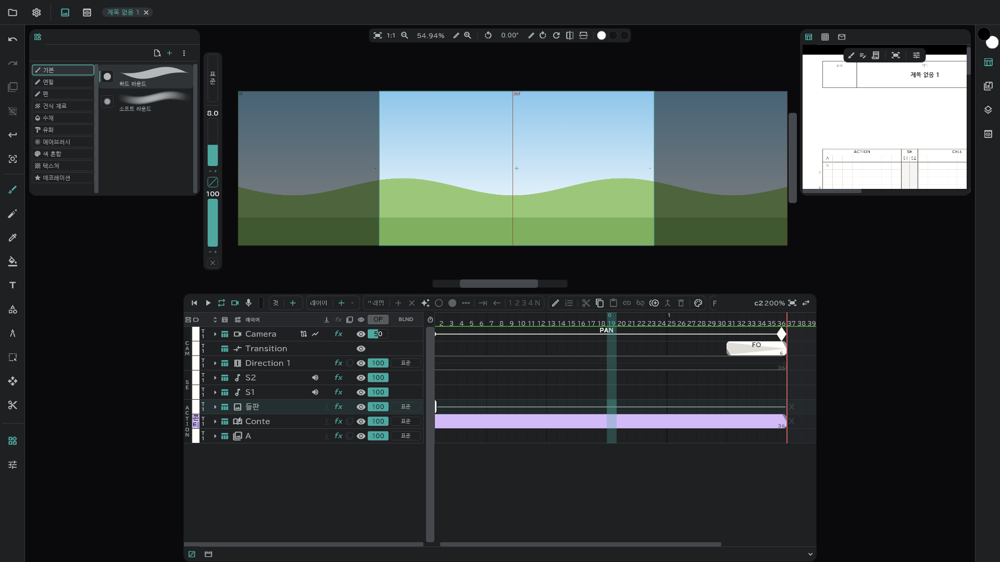

# 이미지 레이어

배경(BG) · 북 같은 **그림 한 장을 컷 전체에** 까는 레이어입니다. 이름은 **BG**, 이미 BG 가 있으면 **BOOK** 으로 생기고, 색 라벨은 **미술 소재** 로 시작합니다.

## 만들기

- **레이어 ＋ ▾ → 이미지**: 빈 이미지 레이어. 그 위에 직접 그립니다.
- **파일에서**: 이미지 파일을 창에 끌어다 놓거나 **프로젝트** → **파일 열기** 로 고르면 **임포트** 창이 열립니다. 줄마다 **넣을 곳**(새 레이어 · 새 컷 · 미디어 …)을 정하고 **임포트** 를 누릅니다. → [미디어 패널과 임포트](/ko/media-pool)
- **미디어 패널에서**: 미디어의 메뉴 → **배치**.

## 파일 그대로 vs 래스터라이즈

임포트할 때 **래스터라이즈** 를 고릅니다.

| | 래스터라이즈 끔(참조) | 래스터라이즈 켬 |
|---|---|---|
| 레이어에 들어가는 것 | 파일을 **가리키는** 그림 — 원본 해상도 그대로 | 캔버스 픽셀로 **구운** 그림 |
| 그 위에 그리기 | 안 됨 | 됨 |
| 놓는 자리 | 레인 맨 위의 **참조**(위치 · 비율 · 회전) | 보통 그림처럼 |
| 미디어 패널 | 남음 | 남지 않음 |

- 참조 이미지 레이어는 이름 옆에 파일 버튼이 붙습니다. 누르면 **래스터라이즈** 할 수 있습니다(나중에 구워도 됩니다).
- 변형 도구로 참조 레이어를 잡으면 캔버스에 상자가 떠서 손으로 옮깁니다.

## 번호가 이어진 그림 · PSD · 동영상

- `A1.png` · `A2.png` 처럼 번호가 이어진 파일은 하나만 골라도 전부 들어옵니다. 동영상처럼 **참조 레이어 하나가 시간에 따라 바뀌며** 보이고, 범위는 미리보기의 IN/OUT 으로 고릅니다. 래스터라이즈하면 장마다 그림이 됩니다.
- PSD 는 **레이어 보존**(레이어 · 폴더를 그대로) 또는 **합치기**(한 장으로)를 고릅니다.
- 동영상은 **그림+소리 / 그림만 / 소리만** 을 고릅니다.

## 알아 둘 것

- 이미지 레이어는 컷 전체를 그림 하나가 덮습니다. 그림을 비울 수는 있지만 칸을 나누지는 않습니다.
- 어니언 스킨은 없습니다. 클리핑 · 블렌드 · 이펙트 · 변형은 됩니다.
- [겸용컷](/ko/linked-cuts)끼리는 **같은 이름** 의 이미지 레이어가 이어집니다.
