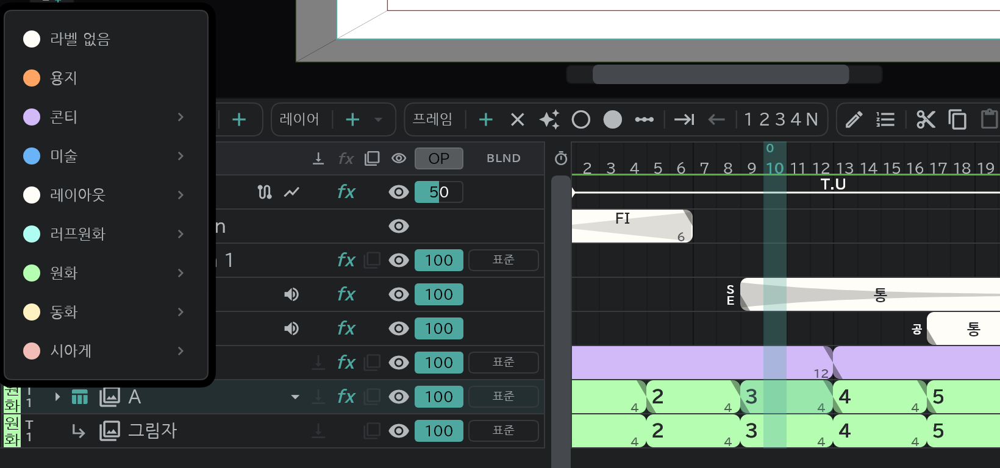

# 색 라벨과 테이크

레이어마다 **공정**(콘티 · 레이아웃 · 원화 · 동화 …)을 붙이면, 줄과 블록에 그 공정의 색이 칠해집니다. 어느 단계의 그림인지 타임라인에서 한눈에 보입니다.

## 라벨 붙이기

줄 맨 왼쪽의 **색 라벨** 칸을 누르고 공정을 고릅니다.

| 공정 | 칩 표기 | 고를 수 있는 수정 |
|---|---|---|
| 용지 | 용지 | (없음) |
| 콘티 | 콘티 | 감독 · 총감독 |
| 미술 | 미술 | 연출 · 작화감독 · 총작화감독 · 감독 · 총감독 · 액션작화감독 |
| 레이아웃 | LO | 〃 |
| 러프원화 | 러프원 | 〃 |
| 원화 | 원화 | 〃 |
| 동화 | 동화 | 위 여섯 + **동화검사** |
| 시아게 | 시아게 | 위 여섯 + **셀검사** |

- 공정을 고르면 옆에 **소재**(그 공정의 작업본)와 **수정** 단계가 펼쳐집니다. 칩에는 둘이 붙어서 「LO작감」처럼 적힙니다.
- **라벨 없음** 으로 지웁니다.
- 새 레이어는 종류에 따라 라벨을 갖고 태어납니다: 애니메이션 = 레이아웃 소재, 콘티 = 콘티 소재, 이미지 = 미술 소재.
- [어태치 레이어](/ko/attach-layers)는 본 레이어의 라벨을 이어받습니다.

## 컷 라벨

컷 전체에도 라벨을 붙입니다: 타임라인 위쪽 **컷** 알약 메뉴 → **레이어 마크**. [겸용컷](/ko/linked-cuts)끼리는 같은 라벨을 씁니다.

## 테이크

라벨 오른쪽 칸은 **테이크**(T1~T9, 처음은 T1)입니다. 같은 공정을 다시 그렸을 때 번호를 올려 둡니다.

## 라벨을 쓰는 곳

- **색 솔로**: 레일 머리 줄의 색 라벨 칸 → 고른 공정의 줄만 남깁니다(**마크 필터 해제** 로 풀기).
- **출력**: [출력](/ko/export) → **셀** 에서 라벨 · 테이크(최신 / 테이크 n)로 내보낼 줄을 고릅니다.
- **스태프**: **설정** → **작품 설정** · 컷의 **컷 설정** 에서 공정마다 담당자를 적습니다. → [타임시트 · 콘티 용지 · 컷 봉투](/ko/sheets)
