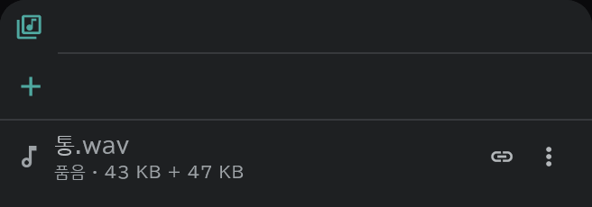

# 미디어 풀

가져온 이미지·소리·영상·PDF 를 모아 두는 곳입니다.

- 화면 오른쪽 세로 막대의 **미디어** 버튼으로 엽니다. **＋**(임포트)는 파일을 고른 뒤 **임포트** 창에서 등록만 합니다.
- 배치는 줄의 **⋮ → 배치…** 로 하거나, 줄을 끌어다 타임라인·캔버스·[콘티](/ko/storyboard)·뷰어에 놓습니다. 그림은 [타임시트·콘티 용지](/ko/sheets)의 칸에 놓으면 사진으로 들어갑니다.
- **품음** 은 파일이 프로젝트 파일 안에 담겨 있다는 뜻, **참조** 는 바깥 파일을 가리킨다는 뜻입니다. 고르는 곳은 임포트 창의 **파일** 열입니다.
- **⋮** 에서 뷰어로 열기·이름 변경·다시 연결·품기·**미디어 삭제** 를 합니다. 쓰이고 있는 미디어를 지우면 배치한 것도 함께 지워진다고 먼저 묻습니다.
- 뷰어 위쪽의 **브러시 허용** 을 켜면 품은 그림·동영상·PDF 페이지에 바로 필기할 수 있습니다.
