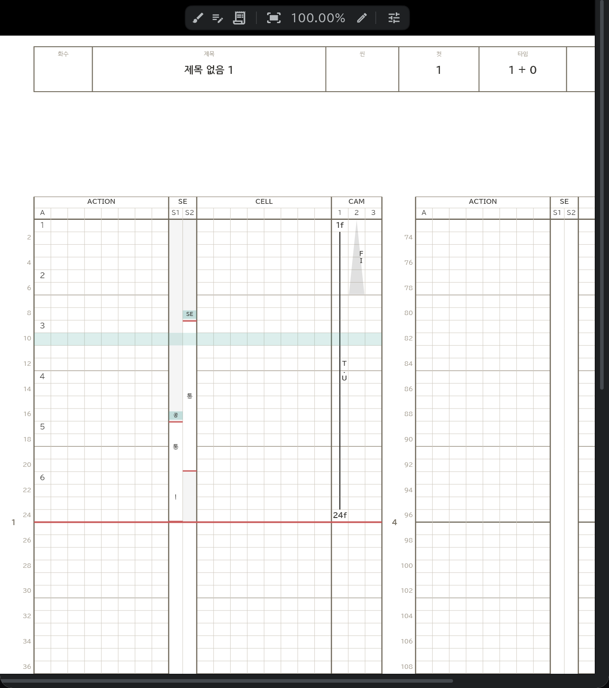
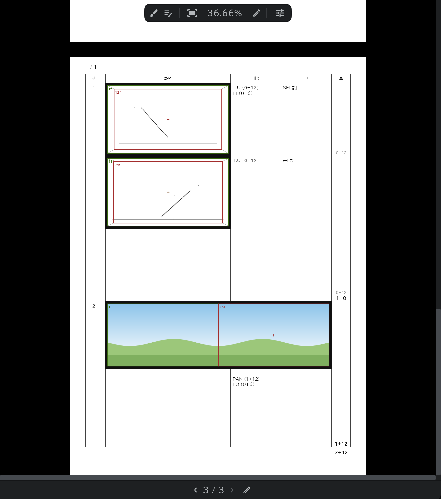

# 타임시트 · 콘티 용지 · 컷 봉투

작업한 내용이 바로 종이 양식에 찍혀, **출력될 모습 그대로** 보면서 작업합니다. 오른쪽 띠의 같은 버튼 하나에 세 탭이 들어 있습니다(처음부터 열려 있음).

## 공통

- 페이지는 패널 아래 띠에서 넘깁니다(이전 · 다음, 또는 페이지 숫자를 끌기).
- 용지 위쪽의 붓 버튼(**브러시 허용**)을 켜면 종이처럼 바로 그립니다. 브러시 · 지우개 · 도형 도구로 그리고, 다른 도구로 누르면 용지가 움직입니다.
- [미디어 패널](/ko/media-pool)의 그림을 용지의 칸에 끌어다 놓으면 사진으로 들어갑니다. 브러시 허용이 켜져 있으면 사진을 잡아 옮기고 크기 · 회전을 바꿉니다.
- 머리의 제목 · 화수 · 컷 · 작화자 칸은 눌러서 그 자리에서 고칩니다. 작품 전체의 제목 · 화수 · 회사 로고 · 표지 그림 · 스태프는 **설정**(⚙) → **작품 설정** 에서 정합니다.
- 보이는 그대로 [출력](/ko/export)됩니다.

## 타임시트

- 타임라인에서 그림 · 대사 · 카메라를 바꾸면 그 자리에서 시트에 찍힙니다. [색 라벨](/ko/layer-labels)이 동화인 줄은 CELL 란에, 다른 그림 줄은 ACTION 란에 찍힙니다.
- SE 란에는 [SE](/ko/sound-layers)의 이름 · 대사가, CAM 란에는 카메라 키 이름과 움직임(PAN · T.U · T.B)과 [디렉션](/ko/camera-section) · [트랜지션](/ko/camera-section)이 찍힙니다.
- 시트에 어느 줄을 올릴지는 레이어 줄의 시트 화살표로 정합니다. → [레이어 한눈에](/ko/layers)
- 보기를 두 가지로 바꿀 수 있습니다: **표기 시트**(반복 · 止め 같은 글자로 줄여 적기) / **데이터 시트**(내보내는 그대로 한 칸씩).

**타임시트 서식**

| 항목 | 내용 |
|---|---|
| 시트 길이 | 한 장에 3초 / 6초 |
| 표시할 칸 | 머리의 제목 · 화수 · 씬 · 컷 · 타임 · 작화자 · 시트 칸 중 보일 것 |
| 늘림 선 · 액션란 / 셀란 | 있음 / 없음 + N — N코마 이상 같은 그림(止め)이나 ×가 이어지면 (N+1)번째 코마부터 선을 긋기 |
| 대사 없는 구간 | 칠함 / 비움 |

## 콘티 용지

- [콘티 레이어](/ko/conte-layer)의 블록 하나가 용지의 한 칸입니다. 칸의 그림 자리에 그리면 그 컷의 콘티 그림이 됩니다.

**콘티 용지 서식**

| 항목 | 내용 |
|---|---|
| 양식 | 아날로그 / 디지털 |
| 화면 검은 외곽선 | 적용 / 미적용 |
| 표지 · 빈 용지 | 넣음 / 뺌 |

## 컷 봉투

- 컷마다의 봉투(컷 정보 · 스태프)를 보여 줍니다. 컷의 스태프는 **컷** 알약 → **컷 설정** 에서 정합니다.
- **컷 봉투 서식** 에서 양식을 고릅니다.
