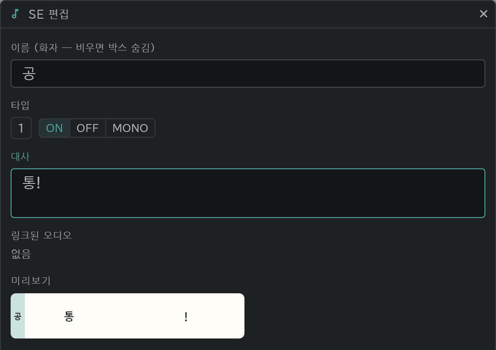

# 사운드(SE) 레이어

효과음 · 대사를 놓는 레이어입니다. 파형을 보며 그림과 타이밍을 맞추고, 이름과 대사는 [타임시트](/ko/sheets)에 그대로 찍힙니다.

## SE 줄

- 타임라인의 **SE** 구역에 **S1 · S2** 두 줄이 처음부터 있습니다. 더 필요하면 **레이어 ＋ ▾ → SE**(콘티 패널에서는 **＋** 만 눌러도 SE).
- SE 줄은 **트랙 전체의 것** 입니다. 컷을 넘어 이어지는 소리도 한 블록으로 놓이고, 어느 컷에서 보든 같은 줄입니다.

## 블록 하나 = 소리 하나

블록을 만들고(**프레임 ＋**) **편집** 또는 더블클릭으로 창을 엽니다.

| 항목 | 내용 |
|---|---|
| 이름 | 화자 이름 등. 비우면 캔버스의 이름표 상자가 숨겨집니다 |
| 타입 | **ON**(화면 안) · **OFF**(화면 밖) · **MONO**(모놀로그) |
| 대사 | 시트의 SE 칸에 적힐 글 |
| 링크된 오디오 | 이 블록이 울릴 소리 파일 |

## 소리 넣기

- **파일에서**: 소리 파일을 창에 끌어다 놓거나 **프로젝트** → **파일 열기** → 임포트 창에서 넣을 곳을 **SE 행** 으로.
- **미디어 패널에서**: 그 소리의 메뉴 → **배치**. → [미디어 패널과 임포트](/ko/media-pool)
- **녹음**: 재생 버튼 옆의 **마이크**를 누르면 플레이헤드 자리부터 녹음하고, 다시 누르면 멈추며 그 테이크가 SE 블록으로 놓입니다. 입력이 너무 커서 깨진 테이크는 블록 모서리가 빨갛게 표시됩니다. → [재생과 녹음](/ko/playback)

## 파형과 오디오 레인

- 파형은 SE 블록 위에 늘 옅게 보입니다.
- **▸** 로 펼친 **오디오** 레인에서 소리를 블록 안에서 밀어 맞추거나, 가장자리를 끌어 페이드를 겁니다.

## 소리 크기 · 음소거 (레이어 오디오)

SE 줄 이름 옆의 **스피커** 버튼을 누르면 그 줄의 믹서가 열립니다: **음소거 · 솔로 · 게인 · 팬**.

## 이름표

블록의 이름은 캔버스에 **이름표** 로도 보입니다. 이름표는 카메라 틀 안의 자리를 지킵니다.

- **이름표** 레인: 크기 · 자간 · 굵게 · 기울임 · 밑줄 · 취소선 · 이름 잉크 · 박스 색 · 대사 잉크 · 대사 표시.
- 이름표도 **변형** · 블렌드 · **이펙트** 를 레이어처럼 받습니다.

## 알아 둘 것

- SE 줄에는 그림을 그리지 않습니다. 클리핑도 없습니다.
- SE 줄 자체는 복사 · 붙여넣기가 되지 않습니다.
- 동영상 · 시퀀스를 출력할 때 **오디오** 를 **SE 믹스를 영상에 먹싱** 으로 고르면 소리가 함께 들어갑니다. → [출력](/ko/export)
