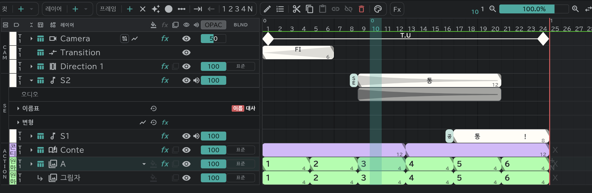

# 사운드 레이어

소리를 SE 줄에 놓고, 파형을 보며 그림과 타이밍을 맞춥니다.

- 왼쪽 위 **프로젝트**(폴더) → **파일 열기…** 로 소리 파일을 고르면 **임포트** 창에서 SE 줄에 놓입니다.
- 파형은 SE 블록 위에 늘 옅게 보입니다. 줄 왼쪽 **▸** 로 펼치면 **오디오** 레인에서 소리를 블록 안에서 밀거나, 가장자리를 끌어 페이드를 겁니다.
- 재생 버튼 옆의 마이크 버튼으로 플레이헤드 위치에 목소리를 녹음합니다.
- SE 블록의 이름·대사는 [편집 버튼](/ko/timeline?id=편집-버튼)으로 넣고, [타임시트·콘티 용지](/ko/sheets)에 그대로 찍힙니다.
- 이름은 캔버스에 이름표로도 보입니다. 이름표는 카메라 프레임 안의 자리를 지키고, SE 줄의 **이름표** 레인(크기·자간·굵게 등)과 **변형**·블렌드·**이펙트** 를 레이어처럼 받습니다.
