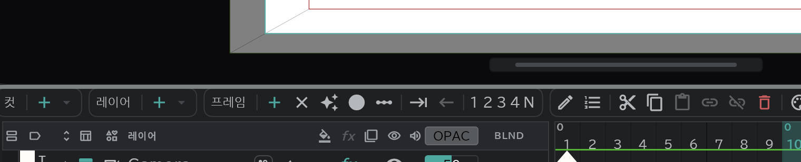
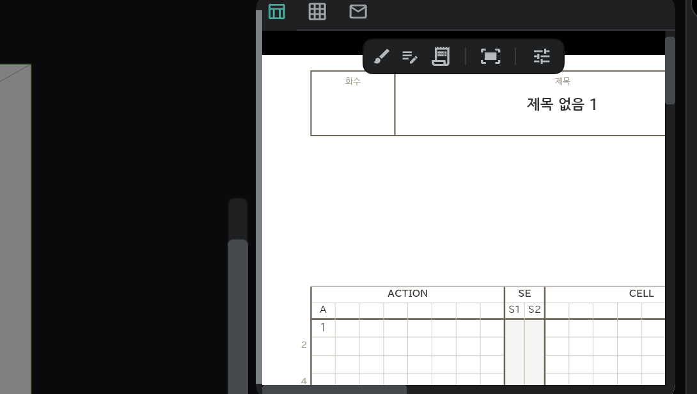

# 시작하기

공이 튀는 짧은 장면을 예로, 그리기까지 필요한 것만 적습니다.

## 컷과 레이어

- 새 프로젝트는 컷 하나, 그림 레이어 A, 첫 칸의 그림까지 있는 채로 열려 바로 그릴 수 있습니다.
- 타임라인 위쪽 **컷 ＋** 로 컷을, **레이어 ＋** 로 그림 레이어를 만듭니다. 새로 만든 컷에는 그림 레이어가 없으니 **레이어 ＋** 로 만듭니다.

## 프레임

- 레이어 줄에서 칸을 고르고 **프레임 ＋** 를 누르면 그 자리에 그림이 생깁니다. 범위를 고르면 범위 전체에 생깁니다.
- **✦**(프레임 자동 생성)를 켜 두면 빈 칸에 그리기만 해도 생깁니다. 블록의 머리가 아닌 칸에 그리면 그 자리에서 블록이 나뉘어 새 그림이 됩니다.

## 그리기

- 왼쪽 도구 막대에서 브러시를 고르고 캔버스에 그립니다. 브러시 종류는 왼쪽 위 목록에서 고릅니다.
- 크기와 불투명도는 화면 오른쪽 위에서 바꿉니다. 연필 버튼으로 숫자를 직접 넣을 수 있습니다. 창이 좁으면 **⋯** 버튼 안에 들어갑니다.

## 재생과 저장

- 타임라인 오른쪽 아래 **▶** 로 재생합니다. 재생 방식은 ⚙ → **프로젝트 설정** 의 **재생 방식** 에서 고릅니다.
- 왼쪽 위 **프로젝트**(폴더) 버튼 → **저장** 으로 저장합니다.
- 여는 것은 같은 메뉴의 **파일 열기…**·**폴더 열기…** 입니다. 파일을 창에 끌어다 놓아도 됩니다. 프로젝트(.anicel·.tvpp·.clip)는 새 탭으로 열리고, 그림·소리·동영상은 **임포트** 창으로 들어갑니다.

## 패널 크기

패널의 가장자리를 끌면 크기가 바뀝니다. 마우스를 올리면 그 가장자리가 밝아집니다.

- 아래 패널(타임라인·콘티): 캔버스 쪽 가장자리로 높이, 양옆 가장자리로 폭. 양옆 가장자리를 두 번 누르면 기본 폭으로 돌아갑니다.

- 옆 패널: 캔버스 쪽 가장자리로 폭, 아래 가장자리로 높이. 같은 쪽 패널들은 폭을 함께 씁니다.
- 모서리를 끌면 폭과 높이가 한 번에 바뀝니다.
