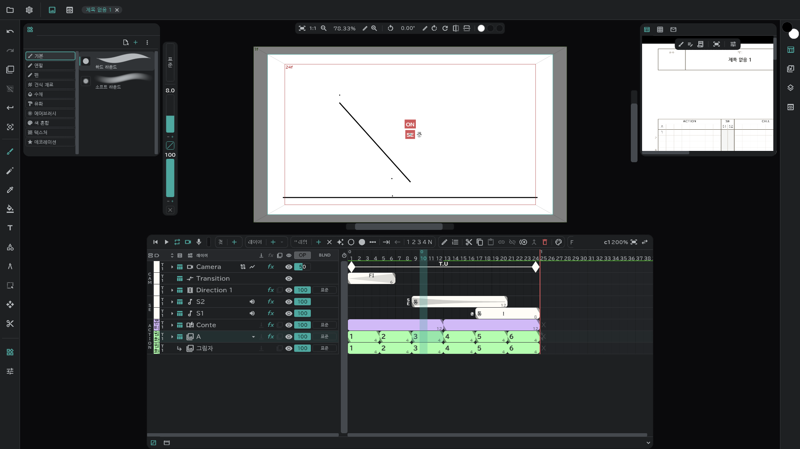
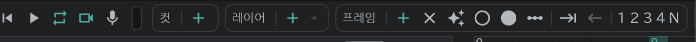

# 처음 그려 보기

새 프로젝트를 열어 그림 몇 장을 그리고, 재생하고, 저장하기까지 순서대로 적습니다.

## 1. 새 프로젝트

- 앱을 켜면 **제목 없음 1** 이라는 새 프로젝트가 열립니다. 다른 새 프로젝트는 왼쪽 위 **프로젝트**(폴더 아이콘) → **새 프로젝트** 입니다.
- 새 프로젝트에는 컷 하나, 그림 레이어 **A**, 첫 칸의 그림까지 들어 있어 바로 그릴 수 있습니다.
- 화면 가운데가 **캔버스**, 아래가 **타임라인**, 왼쪽 세로 막대가 **도구** 입니다. 각 부분의 이름은 [화면과 패널](/ko/screen)에 있습니다.

## 2. 그리기

- 왼쪽 도구 막대에서 **브러시 도구**를 고르고 캔버스에 그립니다.
- 브러시 종류는 왼쪽 위 **도구 라이브러리** 패널에서 고릅니다(기본 · 연필 · 펜 · 수채 …). 자세한 것은 [브러시](/ko/brushes).
- 브러시 **크기** 와 **불투명도** 는 캔버스 왼쪽 가장자리의 세로 알약에서 바꿉니다. 막대를 끌거나 ± 를 누르고, 숫자 옆 연필 버튼으로 숫자를 직접 넣습니다.
- 지우개는 **지우개 도구**, 되돌리기는  또는 도구 막대 맨 위의 화살표입니다.
- 색은 오른쪽 가장자리의 색 버튼(겹친 동그라미 두 개)을 눌러 [색 패널](/ko/color)을 열어 고릅니다.

## 3. 다음 그림 만들기

타임라인에서 한 줄이 레이어 하나, 가로가 시간(프레임)입니다. 색이 칠해진 **블록** 하나가 그림 한 장입니다.

- 레이어 **A** 줄에서 그림을 넣을 칸을 누르고, 타임라인 위쪽 **프레임** 의 **＋** 를 누르면 그 칸에 새 그림이 생깁니다.
- **✦**(프레임 자동 생성)를 켜 두면 빈 칸에 그리기만 해도 그림이 생깁니다.
- 앞 그림을 비춰 보며 그리려면 도구 막대 위쪽의 **어니언 스킨 켜기/끄기**를 켭니다. → [어니언 스킨](/ko/onion-skin)
- 블록 끝을 끌면 그 그림이 보이는 길이(코마 수)가 바뀝니다.

## 4. 재생

- 타임라인 아래쪽의 **▶**(재생)로 재생하고, 다시 누르면 멈춥니다. 반복 재생 · 카메라 뷰 · 녹음 버튼도 거기에 있습니다. → [재생과 녹음](/ko/playback)

## 5. 저장

- **프로젝트** → **저장**으로 저장합니다. 처음 저장할 때 위치와 이름을 정하고, 파일은 `.anicel` 하나로 저장됩니다.
- **자동 저장은 처음에는 꺼져 있습니다.** 꺼져 있으면 저장하지 않고 닫은 작업은 남지 않습니다. 켜 두면 정한 주기(3~60분)마다 프로젝트 파일 자체가 저장됩니다. → [환경설정](/ko/preferences) → **자동 저장**
- 다시 여는 것은 **프로젝트** → **파일 열기** 또는 **최근 프로젝트** 입니다. 파일을 창에 끌어다 놓아도 열립니다. → [열기와 저장](/ko/files)

## 다음으로

- 레이어 종류와 쓰는 법: [레이어 한눈에](/ko/layers)
- 컷을 늘어놓고 콘티 짜기: [콘티 패널](/ko/storyboard)
- 동영상 · 셀로 내보내기: [출력](/ko/export)
