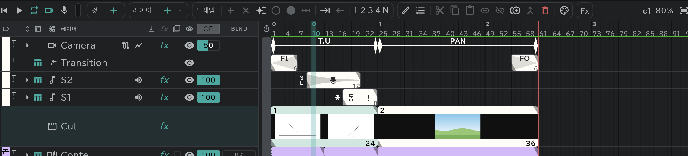

# 콘티

컷을 늘어놓은 공간입니다. **Video** 행의 블록 하나가 컷 하나이고, 컷마다 크기가 달라도 이어서 재생할 수 있습니다.

- 콘티 작업은 컷마다 [콘티 레이어](/ko/conte-layer)를 만들어서 합니다. **Video** 행 바로 아래 **Conte** 행에 콘티 칸이 그려지고, 칸 하나가 [콘티 용지](/ko/sheets)의 한 칸이 됩니다. 그림이 아직 없는 칸은 연하게 보입니다.
- **Video** 행에서는 컷을 고르고 옮기고 길이를 바꿉니다. **Conte** 행에서는 칸을 고르고 길이를 바꿉니다. 블록을 두 번 누르면 컷 이름이나 칸 이름을 바꿉니다.
- CAM 구역 맨 위의 카메라 행에 컷마다 카메라 키와 움직임(PAN·T.U·T.B)이 보입니다. [트랜지션](/ko/camera-section)의 O.L 은 여기서 편집합니다.
- 레일의 행은 끌어서 순서를 바꿉니다.
