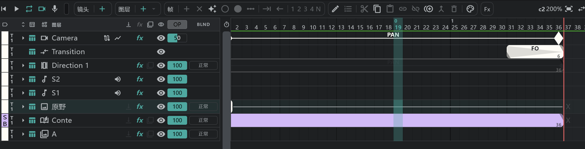

# Camera · Direction · Transition

时间轴顶部的 **CAM** 区段负责摄像机运动和转场。从上到下的顺序 **Camera · Transition · Direction** 是固定的。三者都会直接写进 [摄影表](/zhHans/sheets) 的 CAM 栏。

## Camera

每个镜头自动各有一行（名为 **Camera**）。选中 Camera 行，画布就切换为移动摄像机的状态。

### 移动摄像机

- 用关键帧设定摄像机的 **位置 · 缩放**（推拉）**· 旋转**。展开这一行，三者会变成各自的参数轨。画布、播放和导出都会跟着动。
- 在画布上直接拖动或旋转摄像机框，那一帧上也会出现关键帧。
- 关键帧只能放在该镜头的帧范围内。改变镜头长度时，最后一个关键帧会跟着结尾走。
- 关键帧的速度（进入 · 离开：线性 · 缓动 · 快速 · 平滑 · 保持）和 **影响**，以及位置关键帧的 **路径**（线性 · 贝塞尔曲线 · 连续贝塞尔曲线 · 自动贝塞尔曲线）和 **漂浮**，在关键帧编辑窗口里设置。→ [效果与变换](/zhHans/effects?id=关键帧编辑窗口)
- 贝塞尔路径用画布上的手柄来弯曲。
- Camera 行的 **图表** 按钮会显示 **值 · 速度** 曲线图。

### 自动写入的指示

在两个关键帧之间，如果摄像机框变大，Camera 行上会写 **T.U**；变小写 **T.B**；其他移动或旋转写 **PAN** — 这些也会写到摄影表上。不动的地方什么都不写。

### 摄像机视图与摄像机路径

- Camera 行的 **眼睛** = 摄像机视图（与播放按钮旁边的 **摄像机视图** 相同）。打开后摄像机框以外的部分会变暗；旁边的 **不透明度** 就是变暗的程度。
- 名称末尾的 **摄像机路径** 按钮会在画布上画出摄像机的移动路线。

| 项目 | 内容 |
|---|---|
| 显示 | 关 · **空间**（路线） · **空间＋时间**（路线上每帧一个点） |
| 范围 | **全部关键帧** · **播放头附近** |
| 点间隔 | 点与点之间隔几帧 |
| 前后 | 选播放头附近时，前后各显示几帧 |

- 关闭 Camera 行的 **FX** 格子，导出和播放会跳过摄像机运动（摄像机框不动）。
- 摄像机框的大小在 **设置**（⚙）→ **项目设置** → **摄影机** 里设置（整个项目共用）。→ [项目设置](/zhHans/settings)

## Transition

**每条轨道一个** 的行（名为 **Transition**）。在镜头之间加入转场。

| 记号 | 含义 |
|---|---|
| FI · FO | 从黑色淡入 · 淡出到黑色 |
| WI · WO | 从白色 · 到白色 |
| O.L | 与上一个镜头重叠着切换（叠化） |

- 用 **编辑**  改变种类，拖动块的末端改变长度。画布、播放和导出中都会按原样显示。
- Transition 行的 **眼睛** 决定是否播放淡入淡出。不能重命名、删除或移动。
- O.L 跨两个镜头，所以在 [分镜面板](/zhHans/storyboard) 上编辑。

## Direction

用块来写 **PAN · FIX · T.U** 等摄像机指示的行（名为 **Direction 1** …；每个镜头一行或多行）。这是写在摄影表上的标注，所以不会让画面动。

- 新建一个块，用 **编辑** 打开 **新建指示 / 编辑指示** 窗口。

| 项目 | 内容 |
|---|---|
| 指示（记号） | FIX · PAN · PAN UP · PAN DOWN · SL · Follow · T.U · T.B · Q T.U · Q T.B … |
| 名称 | 留空时为记号的名称 |
| 起点名称（A） · 终点名称（B） | 写在摄影表上 A ⊢──⊣ B 处的内容（例如 PAN 的起点和终点位置） |

- 用 **编辑指示记号** 添加或修改指示（名称 · 图标 · 颜色 · 画法）。
- Direction 行上也可以画画。洋葱皮在这里也能用。
- Direction 行之间可以互换顺序。在 [链接镜头](/zhHans/linked-cuts) 之间不链接。
