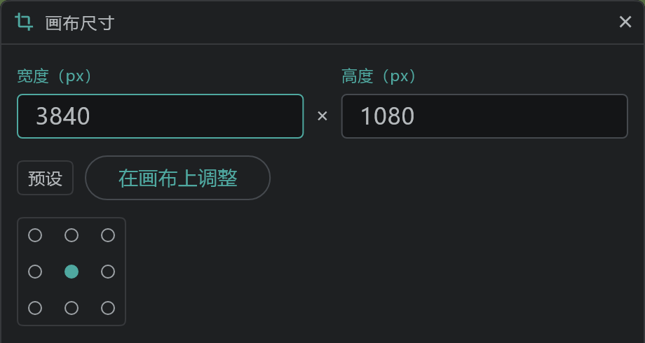

# 各镜头的画布尺寸

每个镜头可以有自己的画布尺寸。比如，只把需要长 PAN 背景的镜头加宽。

- 按时间轴顶部的 **镜头** → 打开 **画布尺寸**。作用于当前镜头；如果它是 [链接镜头](/zhHans/linked-cuts)，与它链接的镜头也会一起改变。
- 从 **预设**（A4 150 · 200 · 300 dpi、HD · FHD · 2K · 4K）里选，或输入宽度和高度，再在 3×3 的格子里选择原有画稿固定在哪个位置。
- 按 **在画布上调整**，窗口会关闭，可以拖动画布的边缘来改变尺寸。与拖动的边相对的那条边不动；用勾号或 Enter 确定。
- 摄影机会跟着画稿一起移动，所以改变尺寸后，框里看到的内容不变。
