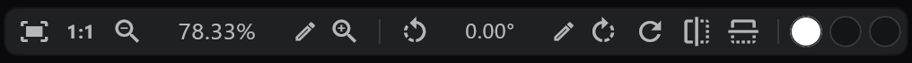

# 画布视图

## 视图胶囊

画布底部的胶囊。空间不够时，部分按钮会收进 **⚙** 里。

| | 按钮 | 按键 |
|---|---|---|
|  | 适应窗口 |  |
|  | 重置缩放（100%） |  |
|  | 缩小 |  |
|  | 放大 |  |
|  | 视图向左旋转 |  |
|  | 视图向右旋转 |  |
|  | 摆正视图（0°） |  |
|  | 视图水平翻转 |  |
|  | 视图垂直翻转 |  |
|    | [画布颜色 · 底板颜色 · 背景颜色](/zhHans/canvas-view?id=颜色) | |

- 左右拖动缩放或角度的数字可以平滑地改变；点铅笔可以直接输入。缩放范围是 10 到 1600%。
- 按键和 ± 按固定档位变化（10 · 25 · 50 · 75 · 100 · 125 · 150 · 200 · 300 · 400 · 800 · 1600%），旋转键每次转 15°。鼠标滚轮以光标为中心缩放。
- 翻转只翻转视图（画稿本身不变）。

## 手动移动

| 按住并拖动 | |
|---|---|
|  | 平移视图 |
|  | 旋转视图 |

- 拖动画布边缘的滚动条也可以平移。
- 触摸和笔的操作见 [触摸与笔](/zhHans/touch-pen)。

## 底板

- 纸张外面也可以画。外面那一圈就是 **底板**。导出时会裁成纸张大小。
- 在 **底板颜色** 窗口里选择是否使用（默认为使用）以及它的大小（纸张的 1.5×、2× 或 3×，默认 3×）。

## 颜色

- **画布颜色**：纸张的底色（仅用于显示，不会进入画稿）。
- **底板颜色**：纸张外面的颜色。
- **背景颜色**：再外面一圈窗口的颜色。

## 摄像机视图

- 打开时间轴播放按钮旁边的 **摄像机视图**，摄像机框以外的部分会变暗。播放时也会按摄像机框显示。
- 变暗的程度就是 Camera 行的不透明度。→ [Camera · Direction · Transition](/zhHans/camera-section)

## 光标

- 在 [偏好设置](/zhHans/preferences) → **Display** 里选择 **Brush / Pen / Crosshair**（默认 Crosshair）。选 **Brush** 时，用鼠标悬停会显示笔尖的形状。
- 用手指触摸时光标会消失。
