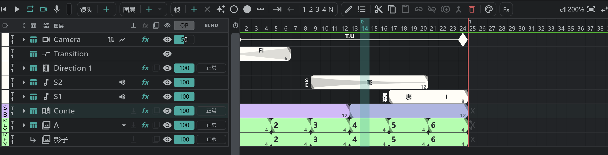

# 分镜图层

用来画镜头分镜的图层。每个镜头 **一个**（名为 **Conte**；颜色标签一开始是 **Storyboard Material**）。

## 新建

- 在时间轴上用 **图层 ＋ ▾ → 分镜**。
- 在 [分镜面板](/zhHans/storyboard) 上，对没有分镜图层的镜头，按 **分镜** 行上的 **＋**。
- 要把已经画好的动画图层变成分镜图层：选中该图层，在 **图层** 胶囊的菜单里勾选 **分镜图层**。取消勾选就会变回动画图层（作为分镜图层时，空单元格会被填满）。
- 镜头里已经有分镜图层时，不能再新建。

## 分格

- **一个块就是 [分镜用纸](/zhHans/sheets) 上的一格**。
- 没有空单元格。一个块一直延续到下一个块或镜头结尾，所以没有 ×（清空）、保持和重复。
- 在块的里面按 **帧 ＋**，会在那里把这一格分开。拖动块之间的分界线，两边的格子会互相让出长度。
- 可以在画布上画，也可以直接画在 [分镜用纸](/zhHans/sheets) 面板上。

## 整条轨道共用的内容

同一条轨道上的镜头共用分镜图层的 **名称 · 颜色标签 · 不透明度 · 混合 · 效果配置 · 附属配置**。在一个镜头里修改，所有镜头都会改变。格子和画稿是各个镜头自己的。

## 附在分镜上的图层

分镜图层上也可以附加 [附属图层](/zhHans/attach-layers)。分镜上的附属图层不能解除附属。

## 导出

- 从 [导出](/zhHans/export) → **分镜用纸** 导出为 PDF（矢量）、PNG 或 JPG。
- 要把分镜当作视频来看，在 [分镜面板](/zhHans/storyboard) 上播放，或导出为序列。
