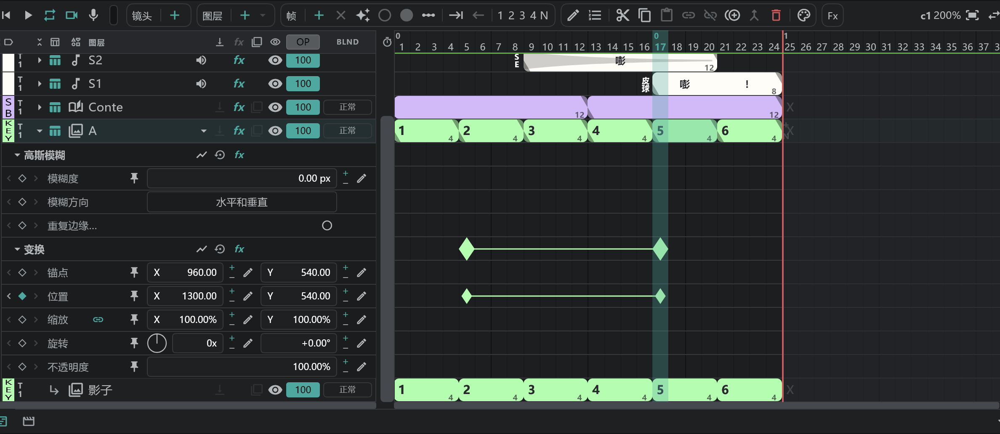
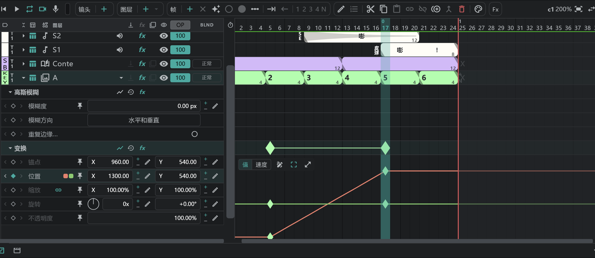

# 效果与变换

按图层行上的 **▸**，打开该图层的 **参数轨**。一条参数轨就是一个数值；在参数轨上放 **关键帧**（◆），这个数值就会随时间变化。

## 变换

动画 · 分镜 · 图像 · 文件夹 · SE 图层都有变换。

- **旋转** 有两个框：圈数和角度（450° = **1x** · **+90.00°**）。在它们前面的转盘上拖动也能旋转。
- 表头行的右边：**图表** · **重置**（数值回到初始；关键帧保留） · **fx**（旁通 / 应用）。
- 用变换工具抓住该图层，可以在画布上用手改变位置、大小和旋转。

## 效果

选中图层，从时间轴的 **Fx** 按钮添加效果。在 [分镜面板](/zhHans/storyboard) 上，分镜行（及其附属行）也从同一个按钮添加 — 加在分镜行上的效果，会出现在该轨道上所有带分镜的镜头里。

| 效果 | 数值 |
|---|---|
| **亮度和对比度** | 亮度 · 对比度（−100–100） |
| **色相/饱和度** | 主色相（−180–180°） · 主饱和度 · 主亮度 |
| **高斯模糊** | 模糊度 · 模糊方向（水平和垂直 / 水平 / 垂直） · **重复边缘像素**（开启时，画布边缘保持实色，不会变透明） |
| **径向模糊** | 数量 · 类型（**旋转** / **缩放**） · 中心（在画布上拖动十字） · 抗锯齿（最佳 / 草稿） |
| **定向模糊** | 方向（角度） · 模糊长度 |
| **相机镜头模糊** | 模糊半径（0–500） · 形状（三角形 – 十边形；一开始是正方形） · 圆度 · 长宽比 · 旋转 · 衍射条纹（只有边缘发亮的光圈） · 重复边缘像素 |
| **颜色键** | 主要操作（**主色**：抠掉选定的颜色 / **保持颜色**：从前一个颜色键抠掉的部分里找回选定的颜色） · 键色 · 容差 · 数量 |
| **赛璐珞编号** | 在画稿上盖赛璐珞编号（A1 …） · 位置 · 缩放 · 颜色（仅动画 · 分镜 · 图像） |

- 从上到下依次作用。顺序可以随意调整。
- 图层行上的 **fx** 格子会一次性旁通 / 应用该图层的所有效果。
- 要去掉一个效果，选中它的表头行，按 **删除**。
- 要对下面所有图层加效果，用 [调整图层](/zhHans/adjustment-layers)。
- Camera 和 Transition 行没有效果。[附属图层](/zhHans/attach-layers) 跟随主图层的变换和效果（分镜图层上的附属图层有自己的）。
- [导出](/zhHans/export) 里的 **图层 FX**：FX 开 / 仅基础 / FX 关。

## 打关键帧

- 在参数轨上按 **◆**，会在播放头所在的帧上用当时的数值打一个关键帧（再按一次删除）。
- 在已有关键帧的参数轨上，拖动数值、用铅笔按钮输入数字、或在画布上拖动手柄，也会在那一帧打关键帧。
- 选中参数轨的单元格后按 **帧 ＋** 也能打关键帧。
- 拖动关键帧可以在时间上移动它。复制 · 粘贴 · 删除与画稿块的操作相同。

## 关键帧编辑窗口

选中关键帧后按 **编辑** ，或双击关键帧。

| 项目 | |
|---|---|
| 名称 | 在链接镜头之间共用 |
| 进入 · 离开 | 从前一个关键帧进来的速度 · 向下一个关键帧出去的速度。**保持** 会让数值一直保持到下一个关键帧 |
| 影响 | 速度变化覆盖区间的多少 |
| 路径 · 漂浮（位置关键帧） | 关键帧之间的路线 · 释放关键帧的时间，让它以均匀的速度通过（第一个和最后一个关键帧除外） |

关键帧标记的形状会随所选的速度而变化。

## 图表

表头行或参数轨上的 **图表** 按钮会在参数轨下面打开图表。

- **值 / 速度**：在数值曲线和速度曲线之间切换。
- 拖动关键帧可以移动它的数值和时间；用手柄调整缓动。
- **钢笔**（开启时，在曲线上点一下就加关键帧 — 关闭时也可以 <kbd class="k-pc">Ctrl</kbd><kbd class="k-mac">⌘</kbd>+点击） · **变换框**（用框来移动和拉伸选中的关键帧） · **放大**。
- 拖动空白处，可以选中框内的关键帧。
- **固定到所有图表**：在看其他图表时，把这条参数轨叠加显示。
