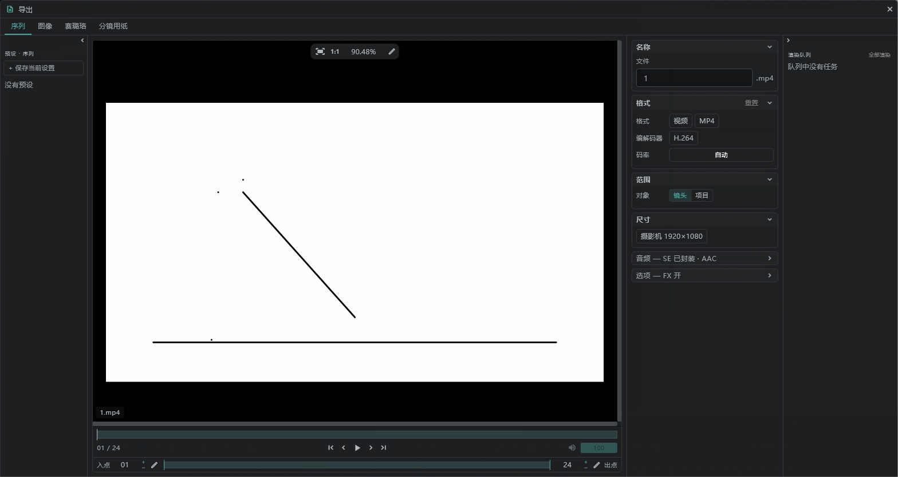
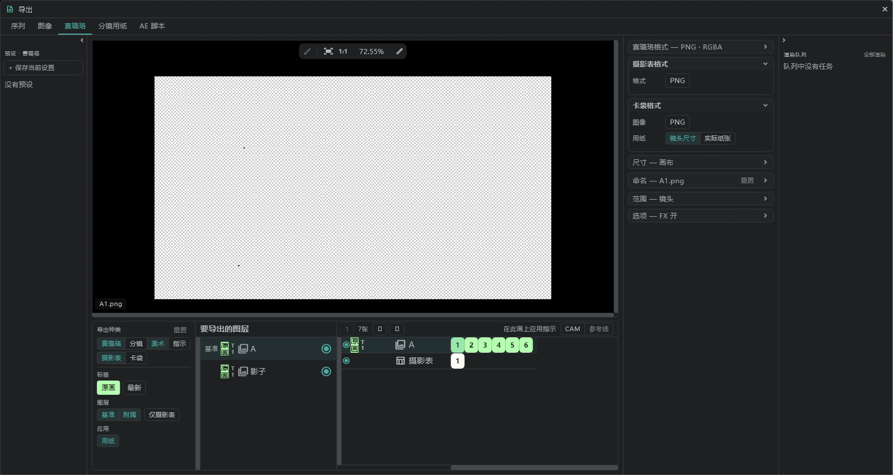

# 导出

所有导出都在一个窗口里完成：左上角的 **项目**（文件夹图标）→ **导出**。

## 标签页

| 标签页 | 导出的内容 |
|---|---|
| **序列** | 视频（MP4 · MOV）或编号图片 |
| **图像** | 只导出当前这一帧（PNG · JPG · PSD · BMP · TGA · TIFF · WEBP） |
| **赛璐珞** | 一张画稿 = 一个文件，以及摄影表和卡袋 |
| **分镜用纸** | 把分镜用纸导出为 PDF（矢量）或 PNG · JPG |

## 序列（视频）

| 项目 | 内容 |
|---|---|
| 命名 | 文件名（编号图片则是命名规则） |
| 格式 | 编号图片 · **MP4**（H.264 · H.265） · **MOV**（H.264 · ProRes Proxy · LT · 422 · HQ · 4444） |
| 编解码器设置 | 码率 · 质量 · 声道 · 背景（白色 / 黑色等） |
| 范围 | **镜头**（当前镜头） / **项目**（所有镜头） |
| 尺寸 | **摄影机**（摄影机框） / **画布** / **画布（按镜头）** |
| 音频 | **将 SE 混音封装进视频** — 把 SE 行的声音也放进去（静音的行除外） |
| 选项 · 图层 FX | FX 开 / 仅基础 / FX 关 |
| IN / OUT | 要导出的区间，在预览里设定 |

- 本设备不能用的编解码器会显示为关闭。如果这台电脑的 PATH 里有 **FFmpeg**，就可以用它导出。
- 导出期间，窗口的设置会锁定，只能按 **取消**。取消时，到那时为止的视频会保留。

## 赛璐珞

一张画稿导出为一个文件。摄影表和卡袋也在这里导出。

| 项目 | 内容 |
|---|---|
| 赛璐珞格式 | PNG · JPG … |
| 摄影表格式 | PNG · JPG · XDTS |
| 卡袋格式 · 尺寸 | 镜头尺寸 / 实际纸张 |
| 导出种类 | 赛璐珞 · 分镜 · 美术 · 指示 · 摄影表 · 卡袋 |
| 标签 | 按 [颜色标签](/zhHans/layer-labels) 和 Take 选择（最新 / Take n）— 例如只导出原画的最新 Take |
| 图层 | **基准**（主图层） · **附属** · **仅律表**（放上摄影表的行） · 自定义 |
| 命名 | 创建文件夹（项目 / 镜头 / 图层） · 前缀 · 位数 · 后缀 |
| 范围 | 选择镜头（在镜头格里逐个开关） |

- 在预览下面的列表里，可以逐个关闭或打开行和画稿。
- 在列表上方的栏里，可以在导出时把指示、摄影机路径和参考线叠加到画稿上。
- 文件名是图层名加画稿编号（例如 `A1.png`）。
- [附属图层](/zhHans/attach-layers) 会和主图层合成一张图导出。
- [链接镜头](/zhHans/linked-cuts) 作为一个镜头处理。摄影表按每个链接镜头分别导出。

## 分镜用纸

- **矢量 PDF**：放大后文字和线条也不会变粗糙的 PDF。用于打印和分发。
- **页面图像**：PNG · JPG，每页一张。

## 预设与队列

- **预设**：在窗口旁边的预设抽屉里，用 **+ 保存当前设置** 给当前设置命名，之后点一下就能读取。
- **队列**：用 **加入队列** 叠加多组设置，再在 **渲染队列** 抽屉里用 **全部渲染** 一次性导出（例如镜头视频 + 赛璐珞 + 摄影表）。

## 保存位置

保存位置会在 **按下导出时** 询问。打开哪个窗口、什么时候打开，取决于 **设备** 和 **输出的文件数量**。导出按钮左边的那一行（“先指定位置，再导出” / “导出后再指定位置”）就是本设备的顺序。

| 设备 | 一个文件 （图像 · 视频 · 分镜 PDF …） | 多个文件 · 文件夹 （赛璐珞 · 序列 · 分镜页面图像 …） |
|---|---|---|
| **Windows · Mac · Linux** | 先出现 **保存窗口** → 导出 | 先出现 **文件夹窗口** → 导出 |
| **iPad · iPhone** | 导出 → 然后出现 **导出窗口** | 导出 → 然后出现 **导出窗口**（整个文件夹） |
| **Android** | 导出 → 然后出现 **保存窗口** | 先出现 **文件夹窗口** → 导出 |

- **文件夹窗口** 是系统里用来选一个文件夹（而不是文件）的窗口。
- 命名规则会为每个镜头或图层建文件夹时，即使只有一个文件也算作“多个 · 文件夹”。
- 取消导出后打开的窗口，结果仍会保留：会询问 **[重新选择] · [丢弃]**。
- **队列**：先询问的设备在 **加入队列** 时询问；后询问的设备在 **全部渲染** 结束后询问一次。

### 直接导出到 Google Drive

| 设备 | 一个文件 | 多个文件 · 文件夹 |
|---|---|---|
| **Windows · Mac** | 可以 — 选 Google Drive 桌面应用在电脑上建立的 Drive 文件夹（Windows 上通常是 **G:** 盘） | 可以 — 同一个文件夹 |
| **Linux** | 选同步工具建立的 Drive 文件夹 | 同左 |
| **iPad · iPhone** | 可以 — 导出窗口里的 Drive | 可以 — 导出窗口里的 Drive（整个文件夹） |
| **Android** | 可以 — 保存窗口里的 Drive | **不可以** — 文件夹窗口里没有 Drive。请导出到本机的文件夹，再用同步应用（Autosync 等）同步 |

## 快速保存一张图

也可以用 **项目** → **另存为** → **PNG · JPG …** 只保存当前这一帧。→ [打开与保存](/zhHans/files)
