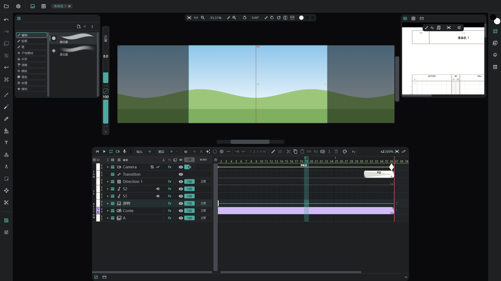

# 图像图层

把 **一张图铺满整个镜头** 的图层，比如背景（BG）或 BOOK。名称为 **BG**，已有 BG 时为 **BOOK**，颜色标签一开始是 **Art Material**。

## 新建

- **图层 ＋ ▾ → 图像**：一个空的图像图层。可以直接在上面画。
- **从文件**：把图片文件拖到窗口上，或者用 **项目** → **打开文件** 选择，会打开 **导入** 窗口。在每一行设好 **放入**（新图层 · 新镜头 · 媒体 …），再按 **导入**。→ [媒体面板与导入](/zhHans/media-pool)
- **从媒体面板**：媒体的菜单 → **放置**。

## 保持文件原样与栅格化

导入时选择是否 **栅格化**。

| | 栅格化关闭（链接） | 栅格化开启 |
|---|---|---|
| 进入图层的是 | **指向** 文件的图片 — 保持原始分辨率 | **烘焙** 成画布像素的图片 |
| 能否在上面画 | 不能 | 能 |
| 摆放位置的调整 | 在参数轨顶部的 **参照** 里（位置 · 缩放 · 旋转） | 与普通画稿相同 |
| 媒体面板 | 保留在那里 | 不保留 |

- 链接的图像图层，名称旁边有一个文件按钮。按它可以 **栅格化**（之后也可以再烘焙）。
- 用变换工具抓住链接图层，画布上会出现一个框，可以用手移动。

## 编号图片、PSD、视频

- 在 `A1.png` · `A2.png` 这样的编号文件中只选一个，就会全部导入。像视频一样，**一个链接图层随时间变化** 来显示；在预览里用 IN/OUT 选择范围。栅格化后，每张图片会变成一张画稿。
- PSD 选择 **保留图层**（图层和文件夹保持原样）或 **合并图层**（合成一张图）。
- 视频选择 **画面 + 声音 / 仅画面 / 仅声音**。

## 须知

- 图像图层用一张图覆盖整个镜头。可以清空这张图，但不能按单元格分开。
- 没有洋葱皮。剪贴、混合、效果和变换都可以用。
- 在 [链接镜头](/zhHans/linked-cuts) 之间，**名称相同** 的图像图层是链接的。
