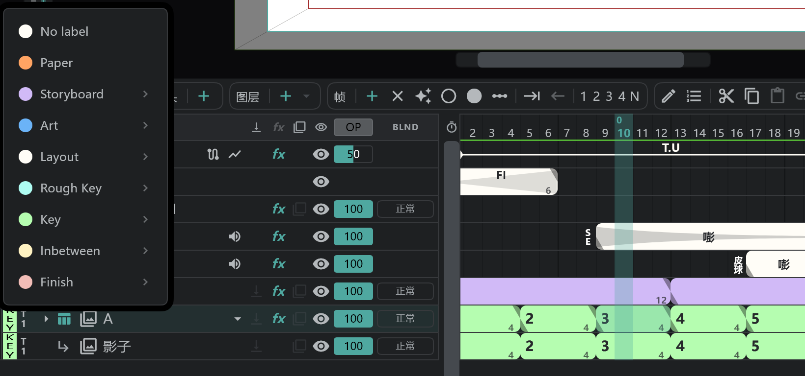

# 颜色标签与 Take

给每个图层指定 **工序**（Storyboard · Layout · Key · Inbetween …），它的行和块就会染上该工序的颜色。在时间轴上一眼就能看出每张画稿处在哪一步。

## 添加标签

按行最左边的 **颜色标签** 格子，选择工序。

| 工序 | 标签上显示 | 可选的修改 |
|---|---|---|
| Paper | PAP | （无） |
| Storyboard | SB | Director · Chief Director |
| Art | ART | Direction · Animation Director · Chief Animation Director · Director · Chief Director · Action Animation Director |
| Layout | LO | 〃 |
| Rough Key | RK | 〃 |
| Key | KEY | 〃 |
| Inbetween | IB | 上面六项 + **Inbetween Check** |
| Finish | FIN | 上面六项 + **Cell Check** |

- 选择工序后，旁边会展开它的 **Material**（该工序的工作稿）和 **修改** 各步骤。标签上把两者合在一起显示，如“LO AD”。
- 用 **No label** 清除。
- 新图层按种类自带标签：动画 = Layout Material，分镜 = Storyboard Material，图像 = Art Material。
- [附属图层](/zhHans/attach-layers) 继承主图层的标签。

## 镜头标签

也可以给整个镜头加标签：时间轴顶部的 **镜头** 胶囊菜单 → **图层标记**。[链接镜头](/zhHans/linked-cuts) 共用同一个标签。

## Take

标签右边的格子是 **Take**（T1–T9，一开始是 T1）。重画同一道工序时，把数字加一。

## 标签的用处

- **按颜色独奏**：轨道头表头行的颜色标签格子 → 只保留所选工序的行（用 **清除标记筛选** 取消）。
- **导出**：在 [导出](/zhHans/export) → **赛璐珞** 里，按标签和 Take 选择要导出的行（最新 / Take n）。
- **人员设置**：在 **设置** → **作品设置** 以及镜头的 **镜头设置** 里，写下每道工序的负责人。→ [摄影表 · 分镜用纸 · 卡袋](/zhHans/sheets)
