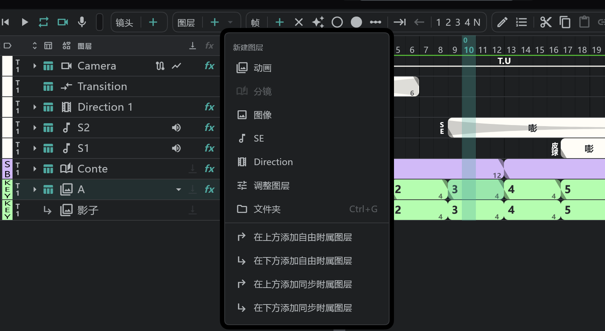

# 图层一览

在时间轴上，**一行就是一个图层**。这些行分成三个区段，左侧的竖条标出每个区段的名称。

| 区段 | 在界面上的位置 | 放在这里的图层 |
|---|---|---|
| **CAM**（摄像机） | 上 | Camera · Transition · Direction |
| **SE**（音效 · 台词） | 中 | SE |
| **ACTION**（画） | 下 | 动画 · 分镜 · 图像 · 文件夹 · 调整图层 |

区段名就是纸质摄影表的栏名。切换到 [摄影表显示](/zhHans/timeline?id=摄影表显示) 后，它们会像纸质摄影表一样变成竖栏，从左到右是 ACTION · SE · CAM。

## 图层的种类

| 种类 | 一句话说明 | 详细 |
|---|---|---|
| **动画** | 基本图层：每个单元格里一张画稿 | [动画图层](/zhHans/animation-layers) |
| **分镜** | 分镜画。一个块就是分镜用纸上的一格 | [分镜图层](/zhHans/conte-layer) |
| **图像** | 背景等一张图，铺满整个镜头 | [图像图层](/zhHans/image-layers) |
| **文件夹** | 把图层编成组，一起显示、隐藏和移动 | [文件夹](/zhHans/folders) |
| **调整图层** | 对它下面所有图层加效果（亮度 · 色相 · 模糊 …） | [调整图层](/zhHans/adjustment-layers) |
| **SE** | 声音和台词。对着波形对时间 | [声音（SE）图层](/zhHans/sound-layers) |
| **Direction** | 在摄影表上写 PAN、FIX 等摄像机指示 | [Camera · Direction · Transition](/zhHans/camera-section) |
| **Camera** | 摄像机运动（位置 · 缩放 · 旋转）。每个镜头一个，自动存在 | 〃 |
| **Transition** | FI · FO · O.L. 等转场。每条轨道一个，自动存在 | 〃 |
| **附属**（不是种类，而是一种附着方式） | 附在主图层上、跟随其运动和效果的图层（阴影、高光） | [附属图层](/zhHans/attach-layers) |

> 新图层的默认名称：动画 **A · B · C …**，图像 **BG**（已有时为 **BOOK**），分镜 **Conte**，调整图层 **FX1**，SE **S1 · S2**，Direction **Direction 1**，文件夹 **Folder 1**，Camera 和 Transition 为 **Camera** · **Transition**。这些名称沿用行业习惯，所以无论应用是什么语言都一样。

## 新建图层

从时间轴顶部的 **图层** 胶囊新建。

- **＋** 新建图层 ：动画图层。在 [分镜面板](/zhHans/storyboard) 上则是 SE 图层。
- **＋ ▾**：选择要新建的种类 — 动画 · 分镜 · 图像 · SE · Direction · 调整图层 · 文件夹，以及在当前图层上方或下方的 **自由 / 同步附属图层**。

## 图层行的各个格子

行的左侧（轨道头）从左到右有这些格子。与该种类无关的格子是空的。

| 格子 | 作用 |
|---|---|
| **颜色标签** | 工序（Storyboard · Key · Inbetween …）。→ [颜色标签与 Take](/zhHans/layer-labels) |
| **Take** | T1–T9 |
| **▸** | 展开参数轨（变换 · 效果 …）。→ [效果与变换](/zhHans/effects) |
| **摄影表箭头** | 这个图层是否放上 [摄影表](/zhHans/sheets) |
| **种类图标 · 名称** | **双击** 名称可以修改。名称旁边可能有链接 🔗、曲线图、折叠等小按钮 |
| **剪贴** | 用下一图层剪贴（只在下一图层的画稿范围内显示） |
| **FX** | 一次性旁通 / 应用这个图层的所有效果 |
| **洋葱皮** | 这个图层的洋葱皮。→ [洋葱皮](/zhHans/onion-skin) |
| **眼睛** | 隐藏 / 显示 |
| **不透明度** | 拖动滑条，0–100% |
| **混合** | 混合模式（正常 · 正片叠底 · 滤色 · 叠加 …）。文件夹默认是 **穿透** |

- 眼睛、洋葱皮、剪贴、FX、摄影表这类开/关格子，**按住后上下划过**，划过的每一行都会变成相同状态。

### 顶部的表头行（一次操作所有图层）

点轨道头最上面一行的格子，会打开该格子的菜单。

| 格子 | 菜单 |
|---|---|
| 区段 | 显示 SE 行 · 显示摄影机行 |
| 摄影表 | 全部放上摄影表 / 全部移出摄影表 · 独奏已上表的行 |
| 颜色标签 | 按颜色独奏 · 清除标记筛选 |
| 种类 | 按类型独奏 |
| 剪贴 | 释放所有剪贴 · 独奏剪贴图层 |
| FX | 应用全部 FX / 旁通全部 FX · 独奏已开 FX 的行 |
| 洋葱皮 | 对显示的图层应用洋葱皮 / 清除显示图层的洋葱皮 · 打开洋葱皮面板 |
| 眼睛 | 全部显示 / 全部隐藏 |
| 不透明度 · 混合 | 作用于所有显示中的图层 |

**独奏** 只保留符合条件的行，其余的暂时隐藏。再按一次取消。

## 选择、移动、删除

- 点名称，那个图层就成为 **当前图层**（画画的地方）。拖动可以选多行。
- 再拖动选中的行，**顺序就会改变。** 放到文件夹上就会进入文件夹。
- 图层不能跨区段移动（比如把绘画图层移进 SE 区段）。CAM 区段里的顺序是固定的 — 从上到下是 Camera、Transition、Direction — 只有 Direction 行之间可以互换顺序。
- 创建副本 · 剪切 · 复制 · 粘贴 · 删除在共用胶囊里。→ [时间轴](/zhHans/timeline?id=共用胶囊)
- 也可以用 **编辑**  改图层名称。选中多行后编辑，会一次全部修改。

## 图层没有的功能

- 没有 **图层锁定**。
- 没有 **透写台**。要透看其他画稿，请用 [洋葱皮](/zhHans/onion-skin)。
- 没有 **文字图层**。用 [文字工具](/zhHans/tools?id=文字) 把文字写进画稿里。
