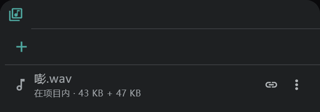

# 媒体面板与导入

**媒体面板**（媒体池）存放导入项目的图片、声音、视频和 PDF；**导入窗口** 是导入文件时决定放到哪里、怎么放的地方。

## 导入窗口

把文件拖到窗口上，或用 **项目** → **打开文件** / **打开文件夹**，或媒体面板里的 **＋**（导入）打开它。

- 最上面一行：选择把所选文件夹作为 **镜头**（整个文件夹作为一个镜头）还是 **自定义**（每一行各放到自己的位置）导入，以及新镜头的 **镜头名称**。
- 一个文件一行。各列：名称 · 修改时间 · 大小 · 分辨率，以及在每一行上设定的内容：

| 列 | 选择的内容 |
|---|---|
| **放入** | 新图层 · 新镜头 · SE 行 · 媒体（只登记到面板里） · 已排除 · “行 · 第 n 格”（已有行的那个单元格） |
| **栅格化** | 开（烘焙成画布图片） / 关（指向文件的 [链接图像](/zhHans/image-layers)） |
| **文件** | **内嵌**（保存在项目文件里） / **链接**（指向外部文件） |
| **适配** | 原始尺寸 · 保持比例拉伸 · 忽略比例拉伸 |
| **选项** | PSD：保留图层 / 合并图层 · 视频：画面 + 声音 / 仅画面 / 仅声音 · 编号图片：范围 |

- 在右边的预览里，设定视频或编号图片的 **IN / OUT**（使用的范围）。
- 如果有问题，底部会出现 **n 条警告**（比如 PSD 的锁定等无法导入的内容）。
- 视频的帧率与项目不同时，会询问是否把项目设为视频的帧率（声音保持其时间）。
- 打开放着图片的 **镜头文件夹**，会按文件夹结构生成镜头和图层。只有一张图片的行会成为图像图层，有多张的会成为动画图层；可以在该行的种类列里更改。

## 媒体面板

用界面右侧栏的 **媒体** 按钮打开。

- 每一行显示 **在项目内 / 链接** 标记，以及使用该媒体的位置（**使用位置** — 点一下就跳过去）。
- **放置**：在行上用 **⋮ → 放置**，或把行拖到时间轴、画布、[分镜面板](/zhHans/storyboard) 或查看器上。把图片拖到 [摄影表或分镜用纸](/zhHans/sheets) 的格子上，会作为照片放进去。
- **⋮** 菜单：在查看器中打开 · 在副查看器中打开 · 放置 · 重命名媒体 · 重新链接 · 收入项目文件 · 导出为 WAV（声音） · 删除媒体。
- 删除正在使用的媒体时会先询问，因为从它放置的内容也会一起删除。

## 链接的文件找不到时

作为链接保存的原文件被移动或删除时，面板顶部会出现 **找不到 n 个媒体文件**。

- **在文件夹中查找**：选择文件移到的文件夹；应用会在里面查找，告诉你找到了几个，并询问是否重新链接。
- 一个一个处理：在行上用 **⋮ → 重新链接**。
- 要把项目带到其他设备上时，用 **收入项目文件** 把原文件保存在项目里比较安全。

## 在查看器上书写

打开查看器顶部的 **允许画笔**，就可以直接在项目里保存的图片、视频和 PDF 页面上书写。
