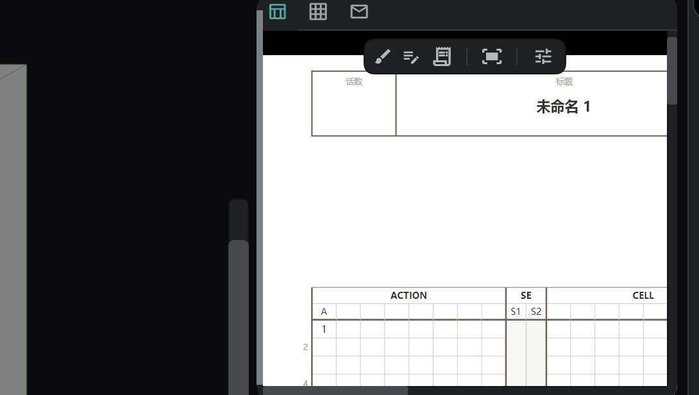
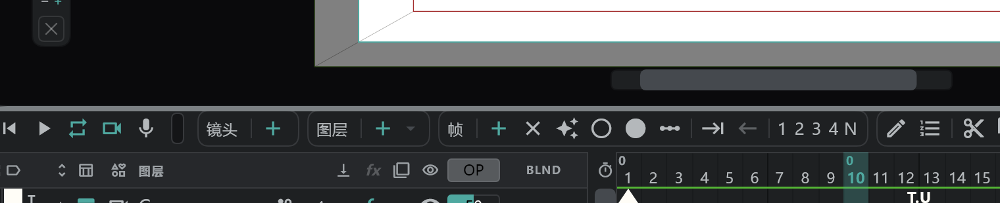

# 界面与面板

## 界面的五个部分

| 位置 | 内容 |
|---|---|
| **顶部栏** | **项目**（文件夹图标）菜单 · **设置**（⚙）菜单 · 画布/查看器切换 · 已打开项目的标签页 |
| **左侧竖条** | 撤销 · 重做 · 洋葱皮 · 取消选择 · 确认 · 独奏按钮，下面是各个 [工具](/zhHans/tools) |
| **两侧栏** | 面板按钮。按一下，对应面板会在画布旁打开 |
| **中间** | **画布**（画画的地方）或 **查看器**（看视频和图片文件的地方） |
| **下方** | **时间轴** 面板和 **分镜** 面板 |

## 打开和关闭面板

- 两侧栏上的一个按钮就是一个 **面板组**。按一下打开该组，再按一下关闭。可以同时打开多个组；打开的组从上往下叠放。
- 把鼠标停在按钮上，可以看到该组里的面板名称。
- 刚安装时，左边的 **工具库** 和右边的 **摄影表 · 分镜用纸 · 卡袋** 是打开的。
- 要把某个面板从界面上完全拿掉或放回来，在 **设置**（⚙）→ **面板** 里勾选。

面板一开始的位置如下。

| 按钮 | 位置 | 面板 |
|---|---|---|
|  | 左 1 | [工具库](/zhHans/tools) |
|  | 左 2 | [工具设置](/zhHans/tools) |
|  | 右 1 | [色轮 · RGB · 色板](/zhHans/color) |
|  | 右 2 | [摄影表 · 分镜用纸 · 卡袋](/zhHans/sheets) |
|  | 右 3 | [媒体](/zhHans/media-pool) |
|  | 右 4 | [洋葱皮](/zhHans/onion-skin) · 工具大小 |
|  | 右 5 | 副查看器 |
|  | 中间 | 画布 · 查看器 |
|  | 下方 | [时间轴](/zhHans/timeline) · [分镜](/zhHans/storyboard) |

## 移动面板

- 把面板的 **标签页**（面板顶部的图标）拖到另一个组的标签行上，面板就会移进那个组。在同一行里拖动可以改变顺序。
- 把标签页放到两侧栏的 **＋**（新建面板组）位置，会出现一个只有这个面板的新组。一条侧栏最多放八个组。
- 标签在一行里放不下时，末尾会出现 **+N**。按它可以看到其余的标签。
- 画布标签页是固定的，不能移动。
- 要把布局恢复到最初的样子，用 **设置**（⚙）→ **面板** → **重置工作区布局**。

## 调整大小

- 拖动已打开面板靠画布一侧的边缘可以改变宽度，拖动面板之间的分界线可以改变高度。拖动角可以同时改变两者。

- 下方时间轴/分镜区域的上边缘也可以拖动来改变高度。按标签行末尾的 **折叠** 可以把它收低，按 **展开** 恢复（快捷键 **折叠 / 展开时间轴区域**）。

## 中间：画布与查看器

- 用顶部栏的 **画布 / 查看器** 切换来选择中间显示什么。如果你把别的面板拖到了中间，它也会出现在这里。
- **查看器** 在你的画之外单独显示视频和图片文件（参考影像等）。**副查看器** 在侧边面板里做同样的事。把文件拖到查看器上，或在 [媒体面板](/zhHans/media-pool) 里用 **在查看器中打开** 来打开文件。

## 更改布局（设置 → 面板）

| 项目 | 作用 |
|---|---|
| **工具条在右侧** | 把工具条移到画布右边 |
| **时间轴区域置顶** | 把时间轴/分镜区域放到界面顶部 |
| **画笔数值放在顶部栏** | 把画笔大小和不透明度的胶囊从画布左边移到顶部栏 |
| **全屏** | （桌面版）窗口占满整个屏幕 |
| **重置工作区布局** | 把面板恢复到最初的位置 |

## 项目标签页

- 打开多个项目时，它们会作为标签页并排在顶部栏上。按标签页切换，按 **✕** 关闭。

## 菜单一览

**项目**（文件夹图标）

新建项目 · 打开文件 · 打开文件夹 · 保存 · 另存为 · 最近的项目 · 导出 → [打开与保存](/zhHans/files) · [导出](/zhHans/export)

**设置**（⚙）

| 项目 | 内容 |
|---|---|
| 作品设置 | 标题 · 集数 · 公司标志 · 封面图 · 人员设置 → [摄影表 · 分镜用纸 · 卡袋](/zhHans/sheets) |
| 项目设置 | FPS · 采样率 · 摄影机尺寸 · 播放方式 → [项目设置](/zhHans/settings) |
| 键盘快捷键 | → [快捷键](/zhHans/shortcuts) |
| 偏好设置 | 输入 · 自动保存 · 音频 · 语言 · Display · 内存 → [偏好设置](/zhHans/preferences) |
| 面板 | 上面说的面板列表和布局 |
| 关于 Anicel | 版本 |
| 发送反馈 | 只发文字，或附上截图和视频 — 设备和版本信息会预先填好 |
