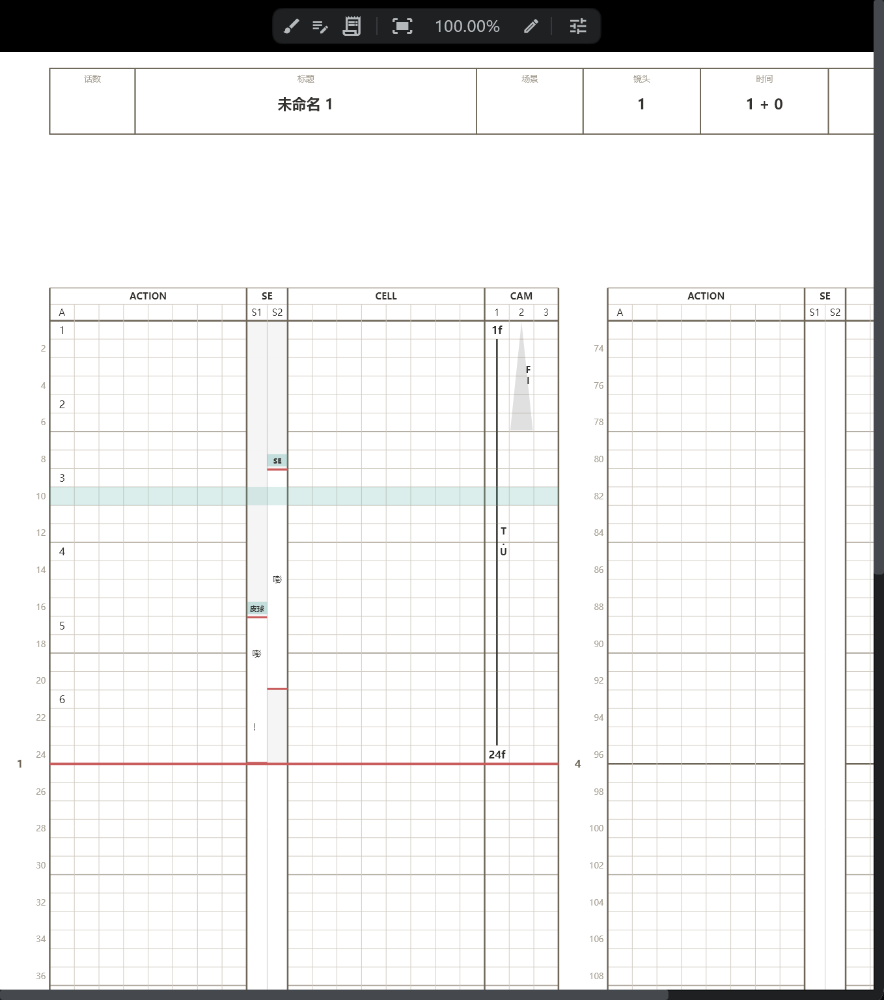
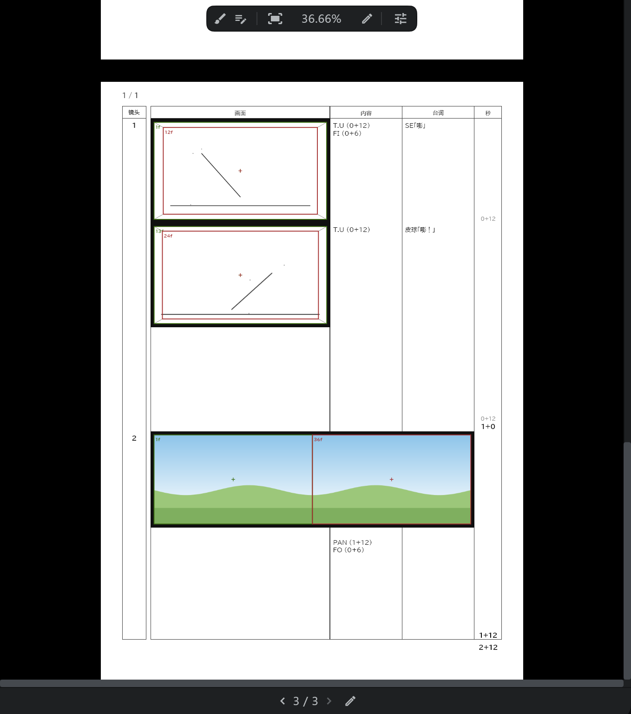

# 摄影表 · 分镜用纸 · 卡袋

工作内容会随时印到纸质表格上，所以可以一边看着 **导出后的样子** 一边工作。右侧栏的一个按钮里有这三个标签页（一开始就是打开的）。

## 三者通用

- 用面板底部的栏翻页（上一页 · 下一页，或拖动页码）。
- 打开表格顶部的画笔按钮（**允许画笔**），就能像在纸上一样直接在上面画。画笔、橡皮和形状工具可以画；用其他工具按下时会移动表格。
- 从 [媒体面板](/zhHans/media-pool) 把图片拖到表格的格子上，会作为照片放进去。打开允许画笔时，抓住照片可以移动它、改变大小和旋转。
- 点表头的标题、集数、镜头、名字等栏，可以就地编辑。整部作品的标题、集数、公司标志、封面图和人员在 **设置**（⚙）→ **作品设置** 里设置。
- 按看到的样子 [导出](/zhHans/export)。

## 摄影表

- 在时间轴上修改画稿、台词或摄影机，摄影表会当场写好。[颜色标签](/zhHans/layer-labels) 为 Inbetween 的行进入 CELL 栏；其他绘画行进入 ACTION 栏。
- SE 栏写入 [SE](/zhHans/sound-layers) 的名称和台词；CAM 栏写入摄影机关键帧的名称和运动（PAN · T.U · T.B），以及 [Direction](/zhHans/camera-section) 和 [Transition](/zhHans/camera-section) 行。
- 哪些行放上摄影表，用各图层行上的摄影表箭头设定。→ [图层一览](/zhHans/layers)
- 可以在两种显示之间切换：**标注表**（用重复、停格（止め）等文字缩写） / **数据表**（一格一格，与导出完全一致）。

**摄影表格式**

| 项目 | 内容 |
|---|---|
| 摄影表长度 | 每张 3秒 / 6秒 |
| 显示的栏位 | 表头的 标题 · 集数 · 场 · 镜头 · 时长 · 作画 · 表号 中显示哪些栏 |
| 延长线 · ACTION / CELL | 有 / 无 + N — 同一张画稿（停格）或 × 连续 N 格以上时，从第 (N+1) 格开始画线 |
| 无台词区间 | 置灰 / 留空 |

## 分镜用纸

- [分镜图层](/zhHans/conte-layer) 的一个块就是用纸上的一格。在格子的画面区域里画，就成为该镜头的分镜画。

**分镜用纸格式**

| 项目 | 内容 |
|---|---|
| 样式 | 传统 / 数字 |
| 画面黑框 | 有 / 无 |
| 封面 · 空白页 | 包含 / 不含 |

## 卡袋

- 显示每个镜头的卡袋（镜头信息 · 人员）。镜头的人员在 **镜头** 胶囊 → **镜头设置** 里设置。
- 在 **卡袋版式** 里选择样式。
