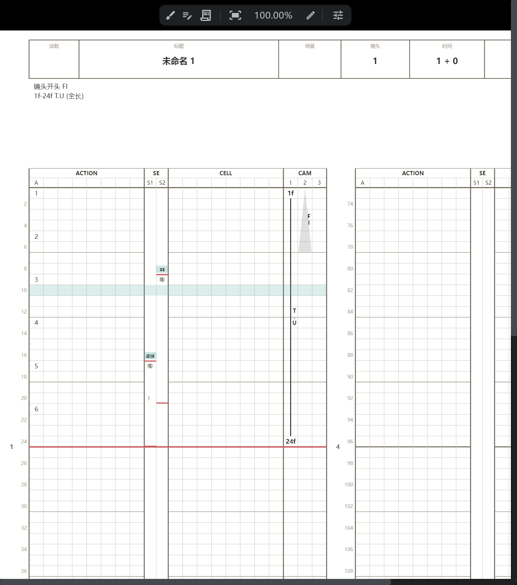
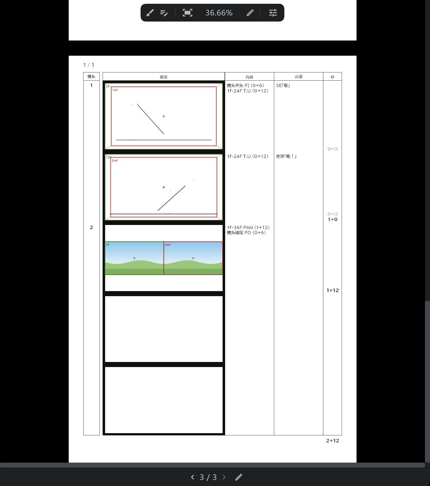

# 摄影表 · 分镜用纸 · 卡袋

工作内容会随时印到纸质表格上，所以可以一边看着 **导出后的样子** 一边工作。右侧栏的一个按钮里有这三个标签页（一开始就是打开的）。

## 三者通用

- 用面板底部的栏翻页（上一页 · 下一页，或拖动页码）。
- 打开表格顶部的画笔按钮（**允许画笔**），就能像在纸上一样直接在上面画。画笔、橡皮和形状工具可以画；用其他工具按下时会移动表格。
- 从 [媒体面板](/zhHans/media-pool) 把图片拖到表格的格子上，会作为照片放进去。打开允许画笔时，抓住照片可以移动它、改变大小和旋转。
- 点表头的标题、集数、镜头、名字等栏，可以就地编辑。整部作品的标题、集数、公司标志、封面图和人员在 **设置**（⚙）→ **作品设置** 里设置。
- 按看到的样子 [导出](/zhHans/export)。

## 摄影表

时间轴与摄影表完全同步。一边实时查看摄影表一边工作。

| 时间轴的栏 | 在这里做什么 | 写到摄影表上的内容 |
|---|---|---|
| **ACTION** | 画画 | ACTION 栏（[颜色标签](/zhHans/layer-labels) 为 Inbetween 的行进入 CELL 栏） |
| **SE** | 制作写有 [SE](/zhHans/sound-layers) 名称和台词的块 | SE 栏写入名称和台词 |
| **CAM** | 编辑摄影机和摄影指示 | CAM 栏写入摄影机关键帧的名称和运动（PAN · T.U · T.B），以及 [Direction](/zhHans/camera-section) 和 [Transition](/zhHans/camera-section) 行 |

- CAM 栏的运动和转场也会以固定文本写进**备注栏**：与分镜用纸相同的文字，只是去掉时间。备注栏分左右两栏，左栏写满后从右栏顶部继续。
- 哪些行放上摄影表，用各图层行上的摄影表箭头设定。→ [图层一览](/zhHans/layers)
- 可以在两种显示之间切换：**标注表**（用重复、停格（止め）等文字缩写） / **数据表**（一格一格，与导出完全一致）。

**摄影表格式**

| 项目 | 内容 |
|---|---|
| 摄影表长度 | 每张 3秒 / 6秒 |
| 显示的栏位 | 表头的 标题 · 集数 · 场 · 镜头 · 时长 · 作画 · 表号 中显示哪些栏 |
| 延长线 · ACTION / CELL | 有 / 无 + N — 同一张画稿（停格）或 × 连续 N 格以上时，从第 (N+1) 格开始画线 |
| 无台词区间 | 置灰 / 留空 |
| 固定文本 | 开 / 关，全局设置和当前镜头设置分开 |

## 分镜用纸

[分镜面板](/zhHans/storyboard) 的时间轴与分镜用纸完全同步。分镜工作不用切换到时间轴面板，在分镜面板中完成。

| 分镜面板的栏 | 在这里做什么 | 写到分镜用纸上的内容 |
|---|---|---|
| **Conte** | 用 [分镜图层](/zhHans/conte-layer) 的块分格 | 一个块就是用纸上的一格。在格子的画面区域里画，就成为该镜头的分镜画 |
| **CAM** | 编辑摄影机和转场 | 格内的摄影机方框，内容栏的运动（PAN · T.U · FIX）和转场（FI · FO · O.L）。FI 和 FO 标上「镜头开头」「镜头结尾」，分别写在第一格最上方和最后一格最下方 |
| **SE** | 制作台词块 | 台词栏写入名称和台词 |

**分镜用纸格式**

| 项目 | 内容 |
|---|---|
| 样式 | 传统 / 数字 |
| 画面黑框 | 有 / 无 |
| 封面 · 空白页 | 包含 / 不含 |
| 固定文本 | 开 / 关，全局设置和当前镜头设置分开 |
| 镜头运动 | 扩大格子 / 收在格内，全局设置和当前镜头设置分开 |

## 卡袋

- 显示每个镜头的卡袋（镜头信息 · 人员）。镜头的人员在 **镜头** 胶囊 → **镜头设置** 里设置。
- 在 **卡袋版式** 里选择样式。
