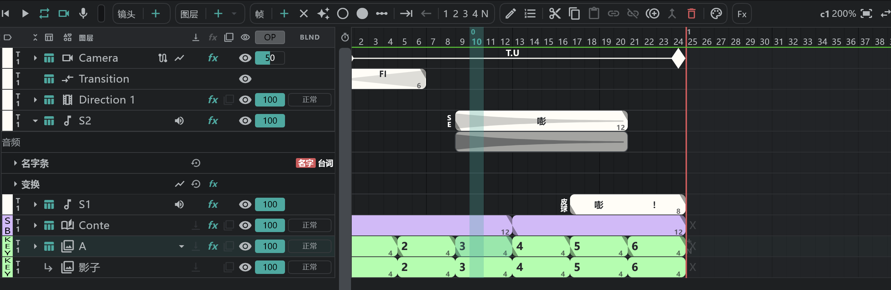

# 声音（SE）图层

放音效和台词的图层。对着波形和画稿对时间；名称和台词会直接写到 [摄影表](/zhHans/sheets) 上。

## SE 行

- 时间轴的 **SE** 区段一开始就有两行 **S1 · S2**。要更多，用 **图层 ＋ ▾ → SE**（在分镜面板上，只要按 **＋** 就会新建 SE 行）。
- SE 行 **属于整条轨道**。跨镜头的声音是一个块，从哪个镜头看都是同一行。

## 一个块 = 一段声音

新建一个块（**帧 ＋**），用 **编辑**  或双击打开它的窗口。

| 项目 | 内容 |
|---|---|
| 名称 | 说话者的名字等。留空时，画布上的名字条会隐藏 |
| 类型 | **ON**（画面内） · **OFF**（画面外） · **MONO**（独白） |
| 台词 | 写进摄影表 SE 栏的文字 |
| 已链接音频 | 这个块播放的声音文件 |

## 导入声音

- **从文件**：把声音文件拖到窗口上，或 **项目** → **打开文件** → 在导入窗口里把放入设为 **SE 行**。
- **从媒体面板**：那段声音的菜单 → **放置**。→ [媒体面板与导入](/zhHans/media-pool)
- **录音**：按播放按钮旁边的 **麦克风** ，从播放头开始录音；再按一次停止，录下的内容会作为 SE 块放上去。因输入过大而削波的录音，块的角会变红。→ [播放与录音](/zhHans/playback)

## 波形与音频参数轨

- SE 块上总会淡淡地显示波形。
- 在用 **▸** 展开的 **音频** 参数轨里，可以在块内滑动声音来对齐，或拖动边缘做淡入淡出。

## 音量与静音（图层音频）

按 SE 行名称旁边的 **扬声器** 按钮，打开这一行的混音器：**静音 · 独奏 · 增益 · 声像**。

## 名字条

块的名称也会作为 **名字条** 显示在画布上。名字条会保持在摄像机框内的位置。

- **名字条** 参数轨：大小 · 字距 · 加粗 · 倾斜 · 下划线 · 删除线 · 名字颜色 · 底框颜色 · 台词颜色 · 显示台词。
- 名字条可以像图层一样加 **变换**、混合和 **效果**。

## 须知

- 不能在 SE 行上画画。也没有剪贴。
- SE 行本身不能复制粘贴。
- 导出视频或序列时，在 **音频** 下选择 **将 SE 混音封装进视频**，声音就会一起导出。→ [导出](/zhHans/export)
