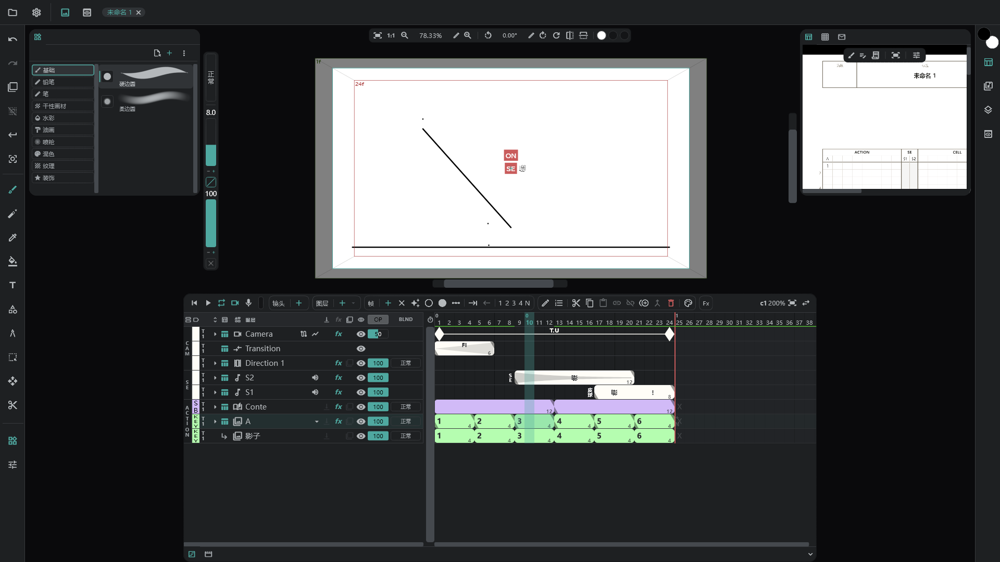
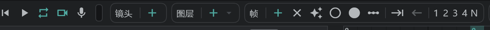

# 快速上手

一步一步来：新建项目，画几张画，播放，然后保存。

## 1. 新建项目

- 应用启动时，会打开一个名为 **未命名 1** 的新项目。要再新建一个项目，请点左上角的 **项目**（文件夹图标）→ **新建项目**。
- 新项目里已经有一个镜头、一个绘画图层 **A**，以及它第一个单元格里的一张画稿，所以马上就能开始画。
- 屏幕中间是 **画布**，下方是 **时间轴**，左侧的竖条是 **工具**。各部分的名称见 [界面与面板](/zhHans/screen)。

## 2. 绘画

- 在左侧工具条上选 **画笔工具** ，在画布上画。
- 在左上角的 **工具库** 面板里选画笔种类（基础 · 铅笔 · 笔 · 水彩 …）。详见 [画笔](/zhHans/brushes)。
- 在画布左边缘的竖向胶囊上调整画笔的 **大小** 和 **不透明度**。拖动滑条或按 ±，也可以用旁边的铅笔按钮输入数值。
- 橡皮是 **橡皮工具** 。要撤销，按  或工具条顶部的箭头。
- 选颜色时，按右边缘的颜色按钮（两个重叠的圆），打开 [颜色面板](/zhHans/color) 选取。

## 3. 画下一张

在时间轴上，一行是一个图层，横向是时间（帧）。一个彩色的 **块** 就是一张画稿。

- 在图层 **A** 的行上，点要放新画稿的单元格，再点时间轴顶部 **帧** 的 **＋**：那个单元格里会出现一张新画稿。
- 打开 **✦**（自动创建帧）后，只要在空单元格里画，就会生成画稿。
- 想一边画一边透看上一张，请打开工具条上方的 **切换洋葱皮** 。→ [洋葱皮](/zhHans/onion-skin)
- 拖动块的末端，可以改变这张画稿显示的长度（格数）。

## 4. 播放

- 点时间轴底部的 **▶**（播放）开始播放，再点一次停止。循环、摄像机视图和录音按钮也在那里。→ [播放与录音](/zhHans/playback)

## 5. 保存

- 用 **项目** → **保存**  保存。第一次会让你选位置和名称；项目保存为一个 `.anicel` 文件。
- **自动保存一开始是关闭的。** 关闭时，没保存就关掉的工作不会保留。打开后，项目文件本身会按你设的间隔（3–60 分钟）保存。→ [偏好设置](/zhHans/preferences) → **自动保存**
- 要再次打开，用 **项目** → **打开文件** 或 **最近的项目**。把文件拖到窗口上也能打开。→ [打开与保存](/zhHans/files)

## 接下来

- 图层的种类和用法：[图层一览](/zhHans/layers)
- 排列镜头、制作分镜：[分镜面板](/zhHans/storyboard)
- 导出视频和赛璐珞：[导出](/zhHans/export)
