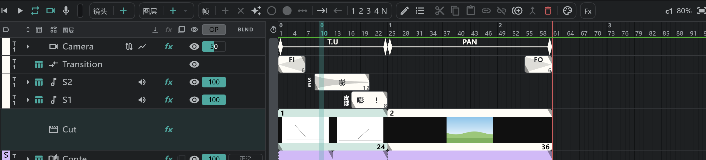

# 分镜面板

把整部作品的 **镜头排在一起** 的面板。如果说时间轴是一个镜头的内部，分镜面板就是把镜头和镜头连起来的外部。即使镜头尺寸不同，也能连续播放。用时间轴面板底部的标签页切换过来。

## 分镜面板的各行

| 行 | 内容 |
|---|---|
| **Camera**（Camera 行） | 各镜头的摄像机关键帧和运动（PAN · T.U · T.B） |
| **Transition**（Transition 行） | FI · FO · O.L 等转场 |
| **Video**（视频轨道） | 一个块就是 **一个镜头** |
| **Conte**（分镜） | 各镜头的 [分镜图层](/zhHans/conte-layer)。一格就是 [分镜用纸](/zhHans/sheets) 上的一格 |
| **S1 · S2 …** | [SE](/zhHans/sound-layers) — 跨镜头的声音也是一个块 |

## 操作镜头

- 在 **Video** 行上选中镜头，拖动来改变顺序，拖动两端来改变长度。
- 新建镜头用 **镜头** 胶囊的 **＋**；创建副本和删除用 **共用** 胶囊里的 **创建副本** · **删除**。
- 双击镜头（或用 **编辑**）可以重命名。
- [链接镜头](/zhHans/linked-cuts) 的镜头名称旁边有 🔗。

## 画分镜

- 在 **Conte** 行上，对还没有分镜图层的镜头，用 **＋** 新建分镜图层。
- 选中格子可以改变长度；双击块可以重命名这一格。还没有画稿的格子会淡淡地显示。
- 在画布上或 [分镜用纸](/zhHans/sheets) 面板里画。

## O.L（叠化）

- O.L 跨两个镜头，所以不在时间轴上，而是在这里的 **Transition** 行上编辑。用 **编辑** 设定种类，拖动块的末端设定长度。
- O.L 期间，Camera 行会分成两半显示，分别对应前一个镜头和后一个镜头。

## 播放

在分镜面板上按 **▶**，会 **连续播放所有镜头**（在时间轴上只播放当前镜头）。→ [播放与录音](/zhHans/playback)

## 须知

- 视频轨道只有一条。
- 在轨道头上拖动行可以改变顺序（CAM 区段的顺序是固定的）。
- 独奏和显示菜单与时间轴相同。→ [图层一览](/zhHans/layers)
