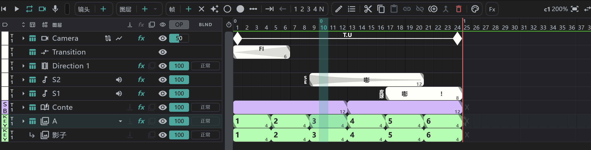
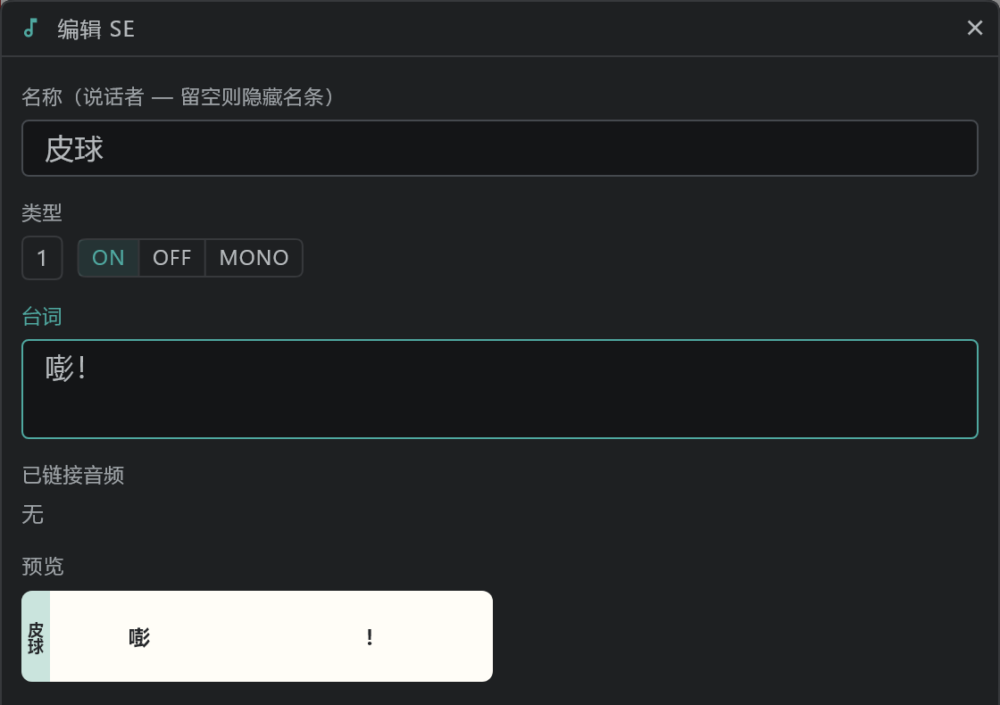

# 时间轴

显示当前镜头的图层和时间的面板。**一行是一个图层；横向是时间（帧）**。图层行的格子和种类见 [图层一览](/zhHans/layers)。

- 一个块就是一张画稿。大数字是画稿名称；块末端的小数字是它的长度（帧数）。
- 面板底部的标签页在 **时间轴** 和 [分镜面板](/zhHans/storyboard) 之间切换。

## 顶部的命令栏

| 位置 | 内容 |
|---|---|
| 左 |      → [播放与录音](/zhHans/playback) |
| 胶囊 | **镜头** · **图层** · **帧** · **共用** · **Fx** |
| 右 | 镜头名称 · 缩放（左右拖动） · 适合窗口 · **⇄**（以摄影表显示 / 以时间轴显示） |

## 选择与移动

块、单元格、图层、关键帧以及 [分镜面板](/zhHans/storyboard) 上的镜头块，都遵循同样的规则。

- **第一次拖动是选择**（一个或多个，也可以跨多行）。
- **再拖动选中的部分就是移动。** 跨多行的选区会一起移动，抓哪一行都一样。
- 移动的画稿落到同一行上同名的画稿上时，会询问是否链接。
- **双击** 块会打开它的编辑窗口（见下面的“编辑”）。

## 镜头胶囊

| 操作 | 内容 |
|---|---|
| ＋ 新建镜头 | 在当前镜头之后新建一个镜头 |
| 编辑镜头备注 | 给镜头写备注 |
| 图层标记 | 镜头标签 → [颜色标签与 Take](/zhHans/layer-labels) |
| 镜头设置 | 这个镜头的人员 |
| 画布尺寸 | → [各镜头的画布尺寸](/zhHans/canvas-size) |
| 创建链接镜头 · 转换为链接镜头 | → [链接镜头](/zhHans/linked-cuts) |

在 [分镜面板](/zhHans/storyboard) 上重命名镜头：选中它的镜头块，用 **编辑**（或双击）。拖动最后一个块后面的镜头结尾手柄，可以改变镜头长度。

## 图层胶囊

| | 操作 | 按键 | |
|---|---|---|---|
|  | 新建图层 |  | 用旁边的 ▾ 选择种类 → [图层一览](/zhHans/layers) |

按 **图层** 打开菜单 — **解除附属** · **栅格化图层** · **分镜图层**（动画 ⇄ 分镜）。

## 帧胶囊

| | 操作 | 按键 | |
|---|---|---|---|
|  | 新建帧 |  | 在选中的单元格里新建一张画稿（在参数轨上则是新关键帧） |
|  | 清空 |  | 把选中的单元格变成空单元格 |
|  | 自动创建帧 |  | 开启时，只要在空单元格里画就会生成画稿 |
|  | 中间画标记1 |  | → [动画图层](/zhHans/animation-layers) |
|  | 中间画标记2 |  |  |
|  | 自动添加中间画标记 |  | 每 n 格加一个标记 |
|  | 推出（空出帧） |  | 在选中的位置空出空单元格 |
|  | 拉回（收拢帧） |  | 收拢选中位置的空单元格 |
|      | 设为 1 · 2 · 3 · 4 · N 格 |  | 一次设定选中块的长度（后面的块会相应收拢或后移） |

按 **帧** 可以 **选择整行**（那一行上的所有块）。

## 共用胶囊

无论选中的是什么（块 · 图层 · 关键帧 · 镜头），都由同一组按钮处理。

| | 操作 | 按键 | |
|---|---|---|---|
|  | 编辑 |  | 所选内容的编辑窗口（[见下](/zhHans/timeline?id=编辑)） |
|  | 自动命名 |  | 从起始编号开始，按顺序给选中的块命名 |
|  | 剪切 |  |  |
|  | 复制 |  |  |
|  | 粘贴独立 |  | 作为新画稿粘贴 |
|  | 粘贴链接 |  | 作为同一张画稿粘贴（改一个，两个都变） |
|  | 取消链接 |  | 把链接的画稿分开 |
|  | 创建副本 |  | 复制选中的图层（在分镜面板上则是镜头） |
|  | 合并 |  | 见下 |
|  | 删除 |  | 删除所选内容（镜头 > 图层 > 单元格中较大的那一级） |
|  | 颜色编辑 |  | 修改或擦除所选画稿的颜色 → [颜色](/zhHans/color) |

**合并** — 把选中的图层（两个以上，或一个文件夹）合成一个图层 — 按看到的样子烘焙，成为最上面的图层（一次撤销）。如果看起来可能会变，会先询问。合并带有附属的图层时，没选中的附属会继续附在结果上。目前会跳过：链接镜头、分镜和链接图像的图层，含有带指示的块的图层，没选主图层而单独选中的附属，以及带有未选中附属、却不在最上面的主图层。

帧选区里有同一行的两个以上的块时，**合并** 会逐行把它们变成 **一个块** — 从最左边的块开始处到最后一个块结束处（包括中间的空单元格），名称取最左边的块，重叠处以最左边块的画稿在上（一次撤销）。

## 编辑

选中块后按 **编辑** ，或双击块，会打开与所选内容相应的窗口。

| 选中的是 | 在窗口里设置的内容 |
|---|---|
| 画稿块（动画 · 分镜 · 图像） | 画稿名称 |
| SE 块 | 名称（说话者） · 类型（ON · OFF · MONO） · 台词 · 已链接音频 → [声音（SE）图层](/zhHans/sound-layers) |
| Direction 块 | 指示（PAN 等） · 名称 · 起点 · 终点 → [Camera · Direction · Transition](/zhHans/camera-section) |
| Transition 块 | 转场的种类（FI · FO 等） |
| 参数轨上的关键帧 | 关键帧的名称 · 速度 · 路径 · 漂浮 → [效果与变换](/zhHans/effects) |
| 图层 | 图层名称（可以多个一起改） |
| 分镜面板上的镜头 | 镜头名称 |

## 摄影表显示

按右端的 **⇄**（以摄影表显示），时间轴会像纸质摄影表一样变成 **竖向**（时间从上往下走；从左到右是 ACTION · SE · CAM 栏）。功能与时间轴相同，方向键也按摄影表的方向走。→ [快捷键](/zhHans/shortcuts)

## 缩放

- 左右拖动右侧的缩放数字，可以改变单元格的宽度。**时间轴适合窗口** 会把整个镜头放进面板。
- 打开 [偏好设置](/zhHans/preferences) → **Display** → **Frame lines inside blocks**，块的里面也会按每一帧画竖线。
